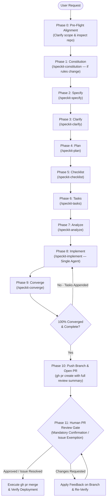

# Project Agent Guidelines: Spec-Driven Development (Spec Kit)

You are the primary autonomous software engineer for **FBUploadPro**. You operate as a **single, unified agent** (no subagent delegation) following **Spec-Driven Development (SDD)** powered by [GitHub Spec Kit](https://github.com/github/spec-kit). Never perform ad-hoc "vibe coding" without documented specifications, architectural blueprints, and atomic task lists.

---

## 1. End-to-End SpecKit SDD & Pull Request Lifecycle

When the user requests a new feature, bug fix, or architectural change, execute this sequential pipeline directly using your loaded skills:

### Phase-by-Phase Execution Protocol
1. **Phase 0 — Pre-Flight Alignment**:
   - Inspect the existing codebase first before asking questions.
   - If critical scope, UX, or security requirements are ambiguous, ask concise multiple-choice questions via `ask_question` (with your recommended option marked).
2. **Phase 1 — Constitution (`/speckit-constitution`)**:
   - Run when establishing or amending project-wide governance principles in `.specify/memory/constitution.md`.
3. **Phase 2 — Specify (`/speckit-specify`)**:
   - Create a dedicated feature branch (`feat/<spec-id>-<short-name>` or `fix/<spec-id>-<short-name>`).
   - Run `/speckit-specify <description>` to generate the technology-agnostic functional specification (`specs/<spec-id>-<short-name>/spec.md`) defining prioritized user stories (P1, P2, P3...), acceptance criteria, and edge cases.
4. **Phase 3 — Clarify (`/speckit-clarify`)**:
   - Proactively scan `spec.md` for ambiguities, gaps, or underspecified constraints, asking targeted questions before planning and encoding answers back into `spec.md`.
5. **Phase 4 — Plan (`/speckit-plan`)**:
   - Generate technical architecture blueprints (`plan.md`), data models (`data-model.md`), contracts (`contracts/`), and validation guides (`quickstart.md`).
6. **Phase 5 — Checklist (`/speckit-checklist <category>`)**:
   - Generate domain requirements quality checklists (`specs/<spec-id>-<short-name>/checklists/<category>.md`) for security, UX, performance, and accessibility.
7. **Phase 6 — Tasks (`/speckit-tasks`)**:
   - Decompose the plan into sequenced, atomic tasks with clear completion criteria in `tasks.md`, grouped by user story priority (P1, P2, P3...).
8. **Phase 7 — Analyze (`/speckit-analyze`)**:
   - Perform a non-destructive cross-artifact consistency and quality audit across `spec.md`, `plan.md`, and `tasks.md` to guarantee full alignment with the project constitution.
9. **Phase 8 — Implement (`/speckit-implement`)**:
   - Execute implementation directly as a **single unified agent** using loaded specialized skills (`taste-skill`, `impeccable`, `ux-writing`).
   - Work strictly task-by-task from `tasks.md`, writing production code and automated tests. Check off completed items in `tasks.md`.
10. **Phase 9 — Converge (`/speckit-converge`)**:
    - Assess the codebase against `spec.md`, `plan.md`, and `tasks.md`. Append any remaining unbuilt work as new tasks to `tasks.md` until 100% convergence is achieved.
11. **Phase 10 — Push Branch & Open PR (`gh pr create`)**:
    - Stage modified/created files along with `specs/<spec-id>/` artifacts and documentation updates (`docs/`).
    - Create a descriptive git commit and push the branch to `origin`.
    - Open a Pull Request using `gh pr create` with a structured summary of changes, user stories completed, and verification evidence.
12. **Phase 11 — Human PR Review Gate & Post-Merge Deployment**:
    - For standard features: present the PR link and wait for explicit human merge approval before running `gh pr merge`. (Exempt for GitHub issues resolution).
    - If UI components in `apps/web` are modified, surface the live Vercel Preview Deployment URL.
    - Post-Merge: If SQL migrations were merged, verify remote Supabase deployment via check-runs on `main`.

---

## 2. Domain Engineering Standards (Single-Agent Scope)

When implementing tasks, adhere strictly to domain standards across monorepo boundaries:

| Scope | Package / Target | Enforced Standard |
| :--- | :--- | :--- |
| **Frontend Web** | `apps/web` | Next.js 16 App Router, React 19 standards (zero `set-state-in-effect`), strict theme token enforcement (ALWAYS reference tokens from `apps/web/tokens/` via the generated `apps/web/src/lib/theme.ts`; NEVER declare ad-hoc styles/colors; status = colour + icon + text), *Taste Skill* anti-slop craft & *Impeccable* quality floor. |
| **Desktop App Shell** | `apps/desktop` | Tauri v2 + Rust. Thin Client / Fat Server IP Isolation (Principle 26), Cargo release profile symbol stripping (`strip = true`, `opt-level = 3`), typed IPC commands via `@fbuploadpro/contracts`, zero client-side storage of raw tokens or publishing secrets. |
| **Browser Companion Shell** | `apps/extension` | Manifest V3 via WXT. Scoped permissions (`activeTab`, `storage`), zero inline script injection, typed contracts via `@fbuploadpro/contracts`, edge API integration via `apps/worker`. |
| **Edge Worker Runtime** | `apps/worker` | Cloudflare Workers edge runtime. Clean architecture, strict Zod schema validation, multi-tenant compound isolation (`user_id`), edge V8 isolate purity (zero Node TCP sockets in worker). |
| **Shared Contracts** | `packages/contracts` | Shared schemas, types, and validations with strict Zod types. Single source of truth for API, IPC, and domain contracts. |
| **Testing & Verification** | Monorepo Test Suites | Real journey testing, zero mock theater, multi-tenant leak prevention tests, edge worker cron validation, desktop IPC smoke & extension MV3 schema tests. |
| **Platform & Tooling** | Turborepo, CI/CD, Docker | Turborepo pipeline caching, GitHub Actions workflows, Wrangler environments, native Cargo toolchain caching, atomic PR hygiene. |

---

## 3. Available Skills (`.agents/skills/`)

The agent operates with specialized skills loaded directly into its execution environment:
- `speckit-constitution`: Sets up or amends project constitution.
- `speckit-specify`: Generates structured feature requirements.
- `speckit-clarify`: Identifies uncertainties and refines specifications.
- `speckit-plan`: Produces architectural and technical plans.
- `speckit-checklist`: Generates verification checklists.
- `speckit-tasks`: Creates implementation task checklists.
- `speckit-analyze`: Audits consistency across artifacts.
- `speckit-implement`: Implements features based on spec artifacts.
- `speckit-converge`: Evaluates completion and logs remaining work.
- `speckit-taskstoissues`: Exports tasks to GitHub issues.
- `impeccable`: Design director and anti-slop craft skill.
- `taste-skill`: Anti-slop frontend design framework.
- `ux-writing`: User-centered, professional interface copy and microcopy, free of developer jargon.

---

## 4. Storage & Artifacts

- All specifications, plans, and active tasks are versioned under `specs/` (e.g., `specs/<feature-id>/spec.md`).
- Project constitution is maintained in `.specify/memory/constitution.md`.
- Shared scripts and templates are located in `.specify/scripts/` and `.specify/templates/`.
- Product vision and architecture reference is in `docs/foundational-knowledge.md`.

---

## 5. Project-Specific Stack & Guidelines

### FBUploadPro Monorepo Substrate
- **Web App**: Next.js 16 (App Router) + React 19 (`apps/web`). Event-driven state transitions only.
- **Edge Worker**: Cloudflare Workers edge runtime (`apps/worker`). V8 isolate execution; communicates with Supabase strictly via `@supabase/supabase-js` over HTTPS.
- **Desktop App Shell**: Tauri v2 + Rust (`apps/desktop`). Thin Client / Fat Server IP Isolation (Principle 26). Cargo profile `strip = true`, `opt-level = 3`. No raw OAuth storage or private publishing algorithms client-side. Local folder watching & native OS file system access via typed IPC.
- **Browser Companion Shell**: Manifest V3 via WXT (`apps/extension`). Minimal scoped permissions (`activeTab`, `storage`). Zero client-side scraping secrets; communicates securely via Edge Worker API and `@fbuploadpro/contracts`.
- **Contracts**: Shared schemas and validations in `@fbuploadpro/contracts` with strict Zod types.
- **Database**: Remote Supabase PostgreSQL substrate accessed exclusively via `@supabase/supabase-js` PostgREST and RPC functions with compound tenant constraints (`user_id`) and Row Level Security.
- **Publishing & APIs**: Facebook Graph API v26.0, Cloudflare R2 media storage.

### Quality & Governance
- Follow coding standards in `.agents/rules/coding-standards.md`.
- **User Approval Gates & GitHub Issues Autonomous Workflow**:
  - **Standard Feature Development**: Requires explicit user approval before committing, creating PRs, or merging.
  - **GitHub Issues Resolution Exemption**: When resolving GitHub issues (e.g. audit-fix, bug fixes, or backlog issues), the agent is explicitly authorized to autonomously create commits, open Pull Requests, and merge PRs without asking for permission.
  - **Non-Negotiable CI & SonarQube PR Gate**: Local quality checks and full builds (`pnpm turbo run build lint typecheck test` and `cargo check`) are NOT run locally by agents before committing or opening PRs. Instead, all validation and builds are executed automatically by the remote CI pipeline upon opening a Pull Request. Before merging any PR, the agent MUST verify that all remote CI checks and SonarQube Cloud analysis pass completely with 100% success and 0 errors. However, if a PR contains only file changes (such as documentation, markdown, specifications, or agent governance files like `*.md`, `docs/**`, `.agents/**`, `.specify/**`), there is no need to check for CI or wait for CI/SonarQube quality gates before merging.
- **Elimination of Local Quality Checks & Builds**: AI agents MUST NOT run local builds, tests, linter runs, or typechecks (`pnpm turbo run build lint typecheck test`, `cargo check`) prior to commit or PR creation. All quality, build, and test verification is offloaded to remote GitHub Actions CI upon PR creation. Agents should commit, push, open the PR, and inspect/verify checks remotely via `gh pr checks <PR_NUM> --watch`. If the PR contains only file changes, inspecting CI checks is not required.
- **Deployment Failure Transparency & Diagnosis**: Whenever a deployment, release pipeline, or CI/CD workflow fails, the agent MUST immediately inspect the execution logs (e.g., via `gh run view --log-failed` or deployment service logs), clearly explain to the user the exact root cause of why it failed (e.g., missing secret, schema migration error, API quota, timeout, or build failure), and outline concrete remediation steps or autonomously apply the fix.
- **Continuous Constitution & Documentation Synchronization**:
  - **On User Directives & Project Insights**: Whenever the user shares new details, business logic, constraints, architectural choices, or domain rules about the project, the agent MUST immediately update `.specify/memory/constitution.md` (for principles & governance) and corresponding documentation under `docs/` (e.g., `docs/foundational-knowledge.md`). Never leave project knowledge isolated in chat history.
  - **Single Combined PR Protocol (Never Separate Docs PRs)**: All documentation updates under `docs/` (e.g., updating roadmap milestone statuses in `docs/foundational-knowledge.md`, architectural knowledge, API contracts, database schemas, or deployment guides) MUST ALWAYS be included and committed directly in the SAME Pull Request as the feature, fix, or code modifications. AI agents and engineers MUST NEVER create separate, standalone Pull Requests solely for documentation synchronization. Code and documentation must always ship together atomically in one PR.
- **Merging Protocol**:
  - For standard feature workflows, explicit user confirmation is required prior to merging into `main`.
  - For GitHub issues, autonomous merging (`gh pr merge --squash --delete-branch`) is permitted once all quality and SonarQube checks pass cleanly.
  - **PRs with Only File Changes (CI Exemption)**: If a PR contains only file changes (such as documentation, markdown files, specifications, or agent rules under `docs/**`, `.agents/**`, `.specify/**`, `*.md`) with no executable code or dependencies, there is no need to check for CI or wait for CI/SonarQube quality gates before merging.
  - **Post-Merge Main Repo Checks (Supabase Migrations Gate)**: If a merged Pull Request includes any SQL migration files under `supabase/migrations/**`, the agent MUST check the status of post-merge deployment on `main` (specifically inspecting check-runs on `main` via `gh api repos/:owner/:repo/commits/main/check-runs --jq '.check_runs[] | select(.app.slug == "supabase")'` for the Supabase deployment check) and verify that database migrations apply with 100% success and 0 errors. If the deployment fails, the agent must immediately inspect the failure logs and remediate any database migration failure. If a PR does NOT contain SQL migration files, post-merge migration checks on `main` MUST be skipped.
- **Strict Theme & Design System Authority (design tokens in `apps/web/tokens/`)**:
  - The single source of truth for all frontend styling, colors, hairlines, spacing, radii, and shadows is the DTCG token source in [`apps/web/tokens/`](apps/web/tokens/). [`apps/web/src/lib/theme.ts`](apps/web/src/lib/theme.ts) and `apps/web/src/styles/tokens.generated.css` are GENERATED from those tokens (Style Dictionary, `tokens:build`) — never hand-edit them; CI runs `tokens:check` and fails on drift.
  - All components MUST import and reference styling properties from `@web/lib/theme` or CSS variables (`globals.css`).
  - NEVER declare, invent, or hardcode ad-hoc hex codes, custom borders, arbitrary shadows, or capsule pill badges anywhere in frontend components.
  - Status indicators must present colour + icon + text together (`STATUS_SIGNALS` supplies colours and labels) — state never travels by colour alone (spec 129 OD-3).
  - Enforced by `.agents/rules/theme-standards.md`.
- **`DESIGN.md` Deleted (2026-10-22, spec 129)**:
  - The repo-root `DESIGN.md` was deleted at the project lead's direction and superseded by the token system above. It is not an authority and must not be recreated or cited as one.
  - The former "never modify DESIGN.md" immutability clause is void.
- **Post-PR Vercel Preview Link Protocol**:
  - UI previews are validated directly via Vercel Preview Deployments generated automatically for every Pull Request. All UI components are verified directly within `apps/web`.
  - When a Pull Request is opened or updated, the agent MUST only surface and present the live Vercel preview deployment URL if the PR includes UI changes (e.g. pages, layouts, styles, components in `apps/web`) for interactive user inspection and review prior to requesting merge approval. For non-UI PRs (pure backend, database migrations, devops, or documentation), do not show a preview link.
- **Prohibition on Running Migrations via Supabase MCP (`apply_migration` / `execute_sql`)**:
  - AI agents and automated tools MUST NEVER use the Supabase MCP server or direct ad-hoc SQL execution tools (`apply_migration`, `execute_sql`, etc.) to run, apply, or execute database schema migrations on the remote database.
  - All database schema modifications MUST be written as versioned forward migration files strictly located in `supabase/migrations/YYYYMMDDHHmmss_<name>.sql` and delivered through GitHub Pull Requests.
  - Migrations are automatically executed by the Supabase GitHub Integration whenever code is pushed or merged into `main`.
  - The Supabase MCP server is strictly limited to read-only inspection and diagnostics (`list_tables`, `list_migrations`, `get_project_url`, `get_publishable_keys`, read-only queries), never for manual schema mutation.
- **Universal Professional UX Writing & Interface Tone Standards**:
  - **Public Product Voice**: FBUploadPro is a commercial SaaS application; every piece of user-visible copy across the entire platform (pages, layouts, headers, modals, forms, helper text, error alerts, empty states, and buttons) MUST be written professionally, clearly, and from the user's perspective.
  - **Zero Technical Plumbing Leaks**: AI agents and engineers MUST NEVER expose backend architecture, internal database mechanics, schema constraints, validation logic, regex sanitization, or infrastructure/DevOps terminology anywhere in the user interface. Copy must focus purely on customer intent, workflows, and outcomes.
  - **Prohibition on Decorative / Simulated Status Indicators**: AI agents and engineers MUST NEVER place cosmetic, fake, or simulated "operational / system health" signals (such as "Online", "Ready", "Operational", or static status dots) on pages, cards, headers, forms, or general UI containers. Status indicators (`StatusDot`, `STATUS_SIGNALS`) are strictly and exclusively reserved for authentic, dynamic entity runtime states (such as live third-party OAuth token validity or queued publishing task execution status).
  - Enforced platform-wide by `.agents/rules/ux-writing-standards.md` and `.agents/skills/ux-writing/SKILL.md`.
