# FBUploadPro: System Architecture, Product Knowledge & Execution Blueprint

---

## 1. Product Vision & Core Mission

**FBUploadPro** is a modern, cloud-native social media automation and video/image publishing SaaS. It empowers content creators, digital marketers, and media operators to manage multiple Facebook profiles, organize rich digital media, and automate high-volume publishing to Facebook Pages through intelligent, slot-based queues with robust multi-tenant data isolation, real-time analytics, and unrestricted publishing entitlement for active users.

---

## 2. System Architecture Diagram & Component Topology

```mermaid
flowchart TD
    subgraph ClientLayer ["Client Ingestion & User Surfaces"]
        UserBrowser["Web Application\n(apps/web - Next.js 16 App Router)"]
        DesktopApp["Desktop Application\n(apps/desktop - Tauri v2 Rust + React 19)"]
        BrowserExtension["Browser Extensions\n(apps/extension - WXT Manifest V3)"]
    end

    subgraph EdgeEntry ["Edge Ingress & Routing (Cloudflare & Vercel)"]
        Apex["Marketing Apex Domain\n(fbuploadpro.com / www)"]
        Gateway["Application Central Gateway\n(app.fbuploadpro.com)"]
        TenantWorkspace["Tenant Subdomains\n({username}.fbuploadpro.com)"]
        IntegrationsHub["Integrations Hub\n({username}.fbuploadpro.com/integrations)"]
    end

    subgraph AppPlane ["Application Control Plane (Next.js 16 App Router)"]
        Web["apps/web\nNext.js 16 App Router + React 19\n(Tenant Subdomain Routing & API Gateway)"]
    end

    subgraph SupabaseCloud ["Supabase (Data Substrate & Identity)"]
        Auth["Supabase Auth (Native SMTP OTP)\n(Identity & Session Management)"]
        PG[("PostgreSQL Substrate\n(Multi-tenant Compound Schemas)")]
        Pooler["Connection Pooler (PgBouncer)\n(Port 6543 / 5432 Direct DDL)"]
    end

    subgraph CloudflareEdge ["Cloudflare (Edge Compute & Object Storage)"]
        Worker["apps/worker\nCloudflare Workers Edge Cron (1-min)\n(SKIP LOCKED Dispatcher)"]
        R2[("Cloudflare R2 Storage\n(Zero Egress Direct Media Ingestion)")]
    end

    subgraph ExternalServices ["External API Gateways"]
        FB["Facebook Graph API v26.0\n(Reels, Feed, Comments, Insights)"]
    end

    UserBrowser --> TenantWorkspace
    TenantWorkspace --> Web
    DesktopApp -->|API Handshake & Presigned Upload Request| Web
    BrowserExtension -->|1-Click Media Ingestion Request| Web
    DesktopApp -.->|Direct Video Upload via Presigned URL| R2
    BrowserExtension -.->|Direct Media Upload via Presigned URL| R2

    Web -->|Auth & User Identity| Auth
    Web -->|HTTPS PostgREST & RLS| PG
    Web -->|Generate Presigned S3 URLs| R2
    Worker -->|Claim due posts via supabase.rpc()| PG
    Worker -->|Stream media assets| R2
    Worker -->|Publish posts & first comments| FB
```

| Component | Host / Runtime | Entrypoints | Core Responsibilities |
|---|---|---|---|
| **Marketing Site** | **Independent Host** | Landing Page, Terms, Privacy | High-converting marketing landing pages, Terms of Service (`/terms`), Privacy Policy (`/privacy`), SEO content, deployed independently. |
| **Web App Gateway** | **Vercel** | `app.fbuploadpro.com` (`apps/web`) | Central authentication gateway, serving `/login`, `/signup`, and cross-subdomain auth handoffs. |
| **Tenant Workspaces** | **Vercel** | `{username}.fbuploadpro.com` (`apps/web`) | User workspace root, publishing queue, accounts, and dedicated tenant tools. |
| **Integrations Hub** | **Vercel** | `{username}.fbuploadpro.com/integrations` (`apps/web`) | Dedicated workspace portal for pairing browser extensions, generating pairing PINs, and downloading desktop installers. |
| **Desktop Application** | **macOS / Windows Native** | `apps/desktop` (Tauri v2: Rust + React 19) | Native stripped binary client; background local folder auto-watching for rendered videos, system tray uploader, and direct R2 presigned ingestion without source code exposure. |
| **Browser Extensions** | **Chrome & Firefox Stores** | `apps/extension` (WXT: Manifest V3) | Single cross-browser extension codebase; 1-click social media clipping directly to Cloudflare R2 Media Library, quick queue status popup, and Facebook session assistant. |
| **Database & Identity** | **Supabase** | Managed PostgreSQL & Supabase Auth | Pure HTTPS PostgREST queries via `@supabase/supabase-js`, native 6-digit SMTP OTP delivery, compound tenant RLS (`auth.uid() = user_id`), and atomic RPC functions for queue concurrency. |
| **Edge Compute** | **Cloudflare** | Cloudflare Workers (`apps/worker`) | Per-minute edge cron triggers, atomic queue locks via `supabase.rpc('claim_due_queue_items')`, direct media streaming to Meta APIs. |
| **Object Storage** | **Cloudflare** | Cloudflare R2 (`media.fbuploadpro.com`) | S3-compatible media asset storage with $0 egress fees, presigned direct PC-to-bucket uploads, thumbnail cache. |
| **Social Publishing** | **Meta** | Facebook Graph API v26.0 | Reels and photo publishing, automatic first comment submission, page insights sync. |

### C. Automated Database Schema Migrations (Supabase GitHub Integration)
- **Canonical Migrations Directory**: `/supabase/migrations/`
- **Naming Standard**: Strict `YYYYMMDDHHmmss_<name>.sql` timestamp pattern (e.g. `20261008120001_initial_schema.sql`).
- **Automated Deployment**: Powered by the **Supabase GitHub Integration** configured in the Supabase Project Dashboard. When code merges to `main`, Supabase automatically executes unapplied migrations in chronological order.
- **Single Primary Instance (Zero Branching)**: Supabase preview branching is disabled (paid tier feature). The system operates strictly against the single production database instance tied directly to the `main` branch.
- **Zero Local DB & Pure Supabase Substrate**: Local PostgreSQL instances and Docker containers are prohibited. Applications and tests communicate strictly with remote Supabase over HTTPS.

---

## 3. Multi-Tenant User Architecture & Domain Routing

The platform adopts a decoupled multi-domain topology:

### A. Domain Routing Strategy
1. **Apex Marketing Domain (`fbuploadpro.com` & `www.fbuploadpro.com`)**:
   - Hosted and deployed independently from the webapp (e.g., custom marketing repo, Framer, Webflow).
   - Serves high-craft landing pages, feature announcements, `/terms`, and `/privacy`.
   - Links "Log In" to `https://app.fbuploadpro.com/login` and "Sign Up" / "Get Started" to `https://app.fbuploadpro.com/signup`.
2. **Central Application Gateway (`app.fbuploadpro.com`)**:
   - The primary entry door to the SaaS application.
   - Hosts public authentication: `/login` and `/signup`.
   - Upon successful authentication, automatically redirects the user to their personal workspace (`https://{username}.fbuploadpro.com`).
3. **Dedicated User Workspaces (`https://{username}.fbuploadpro.com`)**:
   - Every registered user operates within their dedicated tenant subdomain.
   - Authentication cookies are set on the apex wildcard cookie domain (`.fbuploadpro.com`), ensuring uninterrupted session continuity between `app.fbuploadpro.com` and `{username}.fbuploadpro.com`.
   - Facebook accounts, imported Facebook Pages, media assets, and publishing queues are strictly scoped to the active tenant user.
   - Zero cross-user data leakage enforced via database compound constraints (`user_id`) and edge routing guards.

### B. Active Construction & Staging Demo Domain (`vinsmokemedia.online`)
During initial feature assembly, integration testing, and staging, the platform is configured with `vinsmokemedia.online`:
- **Central Application Gateway**: `https://app.vinsmokemedia.online` (`/login`, `/signup`).
- **Dedicated Tenant Workspaces**: `https://{username}.vinsmokemedia.online`.
- **Wildcard Session Cookie**: `.vinsmokemedia.online` (enables cross-subdomain authentication continuity).
- **Supabase Auth Allowlist**: `https://app.vinsmokemedia.online/**` and `https://*.vinsmokemedia.online/**`.
- **Vercel Domains**: `app.vinsmokemedia.online` and `*.vinsmokemedia.online` with CNAME `cname.vercel-dns.com`.

---

## 4. Platform Roles & Governance

The platform operates on a clear three-tier role taxonomy:

| Role | Primary Purpose | Key Capabilities |
|---|---|---|
| **User** | Content Creator / Operator | Connects multiple Facebook profiles, manages personal Media Library, creates custom folders, configures Page queue slots, schedules and publishes unlimited posts without credit checks, and monitors Page insights. |
| **Seller** | Affiliate / Referral Partner | Onboards users via unique referral links/codes. Tracks referred users' activity and workspace usage. |
| **Admin** | Platform & System Controller | Manages platform health, system operations, and user statuses. User onboarding and management is completely automated. |

---

## 5. Dedicated User Media Library

Each user has an isolated, Google Drive-style nested Media Library Explorer (`/media`, internally `/tenant/[subdomain]/media`):

- **Top-Level Workspace Navigation**: Accessible directly below **Home** in the primary sidebar group (`WorkspaceSidebar`).
- **Multi-Media Support**: Full support for both **short-form videos** (Reels / feed videos) and **images** (`video/mp4`, `video/quicktime`, `video/webm`, `image/jpeg`, `image/png`, `image/webp`), including a **`300ms` debounced muted inline `<video>` hover preview** directly inside video cards.
- **Recursive Nested Folder Explorer & URL Sync (`?folder=<id>`)**:
  - Unlimited nested folders and subfolders (`media_folders.parent_id`) with sibling-scoped case-insensitive name uniqueness (`(user_id, parent_id, LOWER(name))`) and circular hierarchy prevention.
  - Interactive Breadcrumb Path Bar (`All Media / Campaign A / Reels`) supporting click navigation, drag-and-drop reparenting, and browser URL synchronization (`?folder=<id>` via `history.pushState` and `popstate` listeners) so browser Back/Forward buttons and page refreshes preserve the active folder.
  - Destructive cascading folder deletion (`DELETE /api/tenant/[subdomain]/media/folders/[folderId]`) with a confirmation dialog displaying the exact recursive subfolder and media file counts before permanently removing all descendant folders and R2 media/thumbnail objects.
- **High-Volume Multi-File & PC Folder Ingestion with Pre-Upload Duplicate Detection & Resumable Controls**:
  - Direct browser-to-R2 presigned uploads (`upload-url` + `confirm`) supporting multi-file selection, whole PC directory selection (`webkitdirectory`), and recursive folder drag-and-drop (`webkitGetAsEntry`), automatically creating/reusing the nested subfolder tree inside the currently open directory.
  - **Pre-Upload Duplicate Detection Modal**: Automatically inspects queued files against existing assets in the resolved target folder(s) (matching case-insensitive `name` and exact `fileSize`) as well as intra-batch duplicates, prompting the operator to **Skip duplicates** or **Upload all anyway**.
  - Bounded concurrency queue (max 3 concurrent uploads) with a **single unified Windows Copy-style progress bar** displaying overall percentage, `Uploading X of Y files...`, and transferred/total bytes—never rendering individual per-file progress bars.
  - **Cooperative Pause, Resume & Retry Failed Upload Controls**: Operators can pause in-flight batch uploads (completing active file transfers before holding remaining queued items), resume without losing progress, and retry only failed uploads via a 1-click **"Retry Failed (N)"** action without re-uploading completed assets.
- **Global Search Across All Nested Folders & Infinite Scroll Pagination**:
  - Typing a search query searches globally across all folders and nested subfolders, returning both matching folders and matching media assets across the entire library, with a clickable folder path link (`Campaign A / Reels`) on each media card or table row to jump directly into its parent folder.
  - Directories or search results exceeding 100 items paginate automatically via an `IntersectionObserver` infinite scroll sentinel and an explicit **"Load more (`Showing X of Y`)"** fallback button.
- **Grid vs. Compact Table View Modes, Aspect Ratio/Caption Filters, Direct Captions & Custom Video Frame Covers**:
  - **Grid View (Default) & Compact Table View Toggle**: Operators can switch between rich visual **Grid View** cards (the default layout) and a high-density **Compact Table View** (`MediaTableRow`) persisted in `localStorage` (`fbuploadpro:media-view-mode`), supporting inline caption editing, multi-select (`Shift + Click`), and quick actions in both views.
  - **Direct Asset Caption (`caption_text`)**: Every video and image has 1 direct editable caption, defaulting automatically on upload confirmation to the filename with its extension stripped (e.g., `My Viral Reel.mp4` $\rightarrow$ `My Viral Reel`), editable inline in Grid View, inline in Compact Table View, and in the full Media Preview Modal.
  - **Custom Video Frame Cover Thumbnail Picker**: Inside the Media Preview Modal, operators can scrub to any frame of a video and click **"Use current frame as cover"** to capture a WebP cover image, upload it to R2 (or persist a data URL fallback), and update `thumbnailKey` / `thumbnailUrl` via `PATCH /api/tenant/[subdomain]/media/[mediaId]`.
  - **Aspect Ratio & Caption Status Filters, Batch Action Bar & Keyboard Shortcuts**: Filter by media type (`All` / `Videos` / `Images`), aspect ratio (`All ratios`, `9:16 Vertical`, `16:9 Landscape`, `1:1 Square`), and caption readiness (`All captions`, `Has caption`, `Missing caption`), sort by `Newest`, `Oldest`, `Name (A–Z)`, or `Largest size`, select contiguous ranges with `Shift + Click`, clear active selections with `Escape`, step through items in the Media Preview Modal with `ArrowLeft` / `ArrowRight` (or Previous/Next buttons), and perform atomic batch operations (`POST /api/tenant/[subdomain]/media/batch`) for **Bulk Move to Folder**, **Bulk Set Caption**, and **Bulk Delete**.
- **Unrestricted Cloudflare R2 Storage**:
  - High-availability object storage powered by **Cloudflare R2** with zero egress fees and zero per-user storage quota caps (`user_storage_quotas` and `caption_templates` abolished in Spec 028).
- **Cloud Media Downloader (`/downloader`, internally `/tenant/[subdomain]/downloader` — Spec 031)**:
  - **Primary Sidebar Sibling**: Positioned directly below **Media Library** in the primary top `SidebarGroup` of `WorkspaceSidebar` (`Home` $\rightarrow$ `Media Library` $\rightarrow$ `Downloader`).
  - **Zero-PC Cloud-to-R2 Ingestion**: Streams remote videos and images directly from the cloud into the user's Cloudflare R2 bucket (`users/{userId}/media/{mediaId}/...` and `users/{userId}/thumbnails/{mediaId}.webp`) and registers them in `media_items` without ever downloading files to the user's local PC.
  - **Hybrid Serverless + Pluggable Link Resolver**: Supports social platforms (TikTok, Facebook Reels/Videos, Instagram Reels/Posts, X/Twitter, YouTube), cloud drive links (Google Drive, Dropbox), OpenGraph media pages, and direct video/image URLs out-of-the-box on Vercel, plus optional delegation to an external Cobalt / `yt-dlp` extractor endpoint (`DOWNLOADER_EXTRACTOR_API_URL`) with strict SSRF protection and 500 MB size limits.
  - **Auto-Provisioned `Downloads` Default Folder & Inline Folder Creation**: Automatically resolves or creates a root-level **`Downloads`** folder in the user's Media Library as the pre-selected default destination, while allowing selection of `All Media` root or any nested subfolder and providing an inline **`New Folder`** button right in the Downloader.
  - **Batch Pasting, Multi-Asset Carousels & Caption Auto-Mapping**: Supports single or multi-line batch URL submission with automatic intra-batch URL deduplication, ingests all supported media items from multi-item/carousel posts, and automatically populates `caption_text` with the original post caption/title from the link (falling back to stripped filename).
  - **Unified Batch Progress & Recent Downloads List**: Displays a unified Windows Copy-style batch progress bar during active downloads and a **Recent Downloads** list below with thumbnail previews, extracted captions, folder paths, 1-click **"Open in Folder"** navigation, and **Retry** actions for failed links.

---

## 6. High-Frequency Facebook Publishing Engine

Publishing is driven by an automated, queue-based slot architecture:

1. **Recurring Queue Slots**:
   - For each connected Facebook Page, users define recurring publishing time slots (e.g., Daily at `09:00`, `13:00`, and `18:00`).
2. **Selective Asset Queueing**:
   - Users select videos or images from their Media Library, assign captions, and add them to target Page queues.
3. **Automated First Comment**:
   - Users can optionally attach a First Comment (calls to action, affiliate links, hashtags) that is automatically posted immediately after the post goes live.
4. **Cloudflare Worker Edge Scheduler**:
   - A high-performance Cloudflare Worker edge cron runs every minute.
   - Atomically claims due queue items using PostgreSQL row-level locks (`FOR UPDATE SKIP LOCKED`).
   - Streams media directly to **Facebook Graph API v26.0**.
   - Submits the automated first comment if configured.
5. **Unrestricted Publishing Entitlement**:
   - Publishing entitlement is unrestricted for all active users (`status = 'active'`) with connected Facebook Pages.
   - Any active user can queue and publish unlimited posts with zero credit checks, balance deduction gates, or token ledgers.
   - Zero reliance on external scraping daemons or VPS downloaders; 100% focused on user-owned creative content.

---

## 7. Dedicated Facebook Page Insights & Analytics

Insights are accessible via dedicated analytics endpoints:

- **Overview & Growth**:
  - Current Fan Count (Likes) & Total Followers Count.
  - Time-series follower growth, daily new follows, and unfollow trends.
- **Content & Video Performance**:
  - Total video views and unique video views.
  - 30-second complete video views and total view time (watch minutes).
  - Media impressions and page views over 7-day, 14-day, and 28-day intervals.
- **Audience Engagement & Reactions**:
  - Total post engagements and action counts.
  - Detailed reaction breakdowns: Likes, Love, Wow, Haha, Sorry, Anger.
- **Demographics**:
  - Audience distribution by top countries and top cities.

---

## 8. Zero-Token Architecture & Unrestricted Publishing Policy

- **Token Economy Purged**: The prepaid token system, token ledger, and credit balance model have been formally abolished. Database columns (`tokens_balance`, `tokens_deducted`) and tables (`token_transactions`) are removed via clean DDL rewrite.
- **Unrestricted Publishing**: Any user with `status = 'active'` and connected Facebook pages can queue and publish unlimited posts without credit checks or balance deductions.
- **On-Demand Extension**: All billing, subscription monetization, or specialized workflows will be specified and implemented strictly upon explicit user direction.

---

## 9. Current Specifications & Platform Status

```mermaid
flowchart LR
  subgraph Done [Completed & Merged]
    M1[Spec 001: Monorepo Foundation & DB]
    M2[Spec 002: Auth & Subdomain Routing]
    M3[Spec 003: FB Graph API v26.0 & Accounts]
    M4[Spec 004: Dedicated Media Library & R2]
    M5[Spec 005: Automated Queue Slots Engine]
    M6[Spec 006: Dedicated Page Insights]
    M7[Spec 007: Purge Token System]
    M8[Spec 008: Essential Reusable UI Components]
    M9[Spec 009: Supabase Login & Signup Flow]
    M10[Spec 010: Auth UI/UX Redesign & Default Login]
    M11[Spec 011: Password Reset & Recovery Flow]
    M12[Spec 012: Auth Security Leak Prevention & Fault-Tolerant Resilience]
    M13[Spec 013: Auth OTP Confirmation & Subdomain Hardening]
    M14[Spec 014: Shared Shadcn-Compatible Sidebar Component]
    M15[Spec 015: Gmail Canonicalization, Phone E.164 & OTP Hardening]
    M16[Spec 016: Auth UX Refinement & Inline Validation]
    M17[Spec 017: Auth Flow Audit Remediation]
    M18[Spec 018: Unified 6-Digit OTP Password Reset Flow]
    M19[Spec 019: Pure Sidebar-Only Workspace App Shell]
    M20[Spec 020: Canonical Post-Auth Home Landing Route]
    M21[Spec 021: Auth Lifecycle, Session & Shell Hardening]
    M22[Spec 022: Left-Aligned Authentication Split Layout]
    M23[Spec 023: Supabase Auth Native SMTP OTP Delivery Migration]
    M24[Spec 024: Native Supabase Auth Lifecycle & Cooldown Resilience]
    M25[Spec 025: Facebook Metadata Ingestion & PostgreSQL Status ENUMs]
    M26[Spec 026: Production Shadcn Sidebar Rebuild]
    M27[Spec 027: Dedicated Facebook Accounts Management]
    M28[Spec 028: Purge Media Library Bloat]
    M29[Spec 029: Nested Media Library Explorer]
    M30[Spec 030: Facebook Accounts UX & Workflow Hardening]
    M31[Spec 031: Facebook Accounts Resilience & Page Token Sync]
    M32[Spec 032: Media Library View Modes, Upload Controls & Filters]
    M33[Spec 033: Cloud Media Downloader]
    M34[Spec 034: Dedicated Facebook Pages Management]
    M35[Spec 035: Desktop Shell Embedded View & Frameless Parity]
    M36[Spec 036: Dedicated Facebook Page Workspace]
  end

  subgraph CurrentFocus [Active Priority]
    UIRecreate[Feature Views Assembly: Spec 005-006 Publishing & Insights Integration]
  end

  M1 --> M2 --> M3 --> M4 --> M5 --> M6 --> M7 --> M8 --> M9 --> M10 --> M11 --> M12 --> M13 --> M14 --> M15 --> M16 --> M17 --> M18 --> M19 --> M20 --> M21 --> M22 --> M23 --> M24 --> M25 --> M26 --> M27 --> M28 --> M29 --> M30 --> M31 --> M32 --> M33 --> M34 --> M35 --> M36 --> UIRecreate
```



- **Spec 001 (Completed & Merged)**: Turborepo monorepo, dual Node/Edge database clients, baseline schema, health probes.
- **Spec 002 (Completed & Merged; UI Slated for Assembly)**: Native Web Crypto HMAC-SHA256 session auth, subdomain routing middleware, RBAC shell.
- **Spec 003 (Completed & Merged)**: Facebook Graph API v26.0 OAuth, AES-256-GCM encrypted token storage, selective page discovery, multi-account management UI.
- **Spec 004 (Completed & Merged)**: Dedicated Media Library & Cloudflare R2 Uploads (direct presigned upload/confirm, folder hierarchy).
- **Spec 005 (Completed & Merged; UI Slated for Assembly)**: Automated Queue Slots Publishing Engine & Edge Dispatcher (recurring slot definitions, Cloudflare Worker edge dispatcher with `FOR UPDATE SKIP LOCKED`, Facebook Graph API v26.0 video/photo publisher, automated first comment).
- **Spec 006 (Completed & Merged; UI Slated for Assembly)**: Dedicated Facebook Page Insights (Server-side proxy, 15m cache, time-series followers, video views, watch time, reactions, demographics, worker daily snapshot cron sync).
- **Spec 007 (Completed & Merged)**: **Purge Token System & Enforce Unrestricted Publishing** (Abolished prepaid token credits, token transactions, atomic token decrements, queue balance gates, clean DDL purge of `tokens_balance` / `tokens_deducted` / `token_transactions`, and granted unrestricted publishing for active users).
- **Spec 008 (Completed & Merged into main)**: **Essential Reusable UI Components** (15 production-ready, accessible React 19 primitives in `apps/web/src/components/ui/`: Button, Input, Textarea, Checkbox, Switch, Select, Card, Dialog/Modal, Tabs, Table, StatusDot, Tag, Skeleton, Alert, Tooltip with 325 passing unit tests).
- **Spec 009 (Completed & Merged into main)**: **Supabase Authentication, Login & Registration Flow** (Full registration with Name, Phone, Email, Password; real-time automatic subdomain derivation stripping dots and plus tags; Supabase Auth integration; root-domain cookie scoping `.fbuploadpro.com`; automatic redirect to `{subdomain}.fbuploadpro.com`; dual-theme UI using Spec 008 primitives).
- **Spec 010 (Completed & Merged into main)**: **Professional Auth UI/UX Redesign & Default Login Page** (Eliminated placeholder landing card; configured root `/` to redirect directly to `/login`; crafted professional split-screen layout with brand showcase and feature pillars; added accessible show/hide password toggle; removed subdomain preview box from `/signup` for clean UX).
- **Spec 011 (Completed & Merged into main)**: **Password Reset & Recovery Flow** (Added "Forgot password?" link on sign-in form; created `/forgot-password` recovery email portal with confirmation state; created `/reset-password` credential update form with password confirmation and minimum length validation; added backend recovery endpoints via Supabase Auth).
- **Spec 012 (Completed & Merged into main)**: **Auth Security Leak Prevention & Fault-Tolerant Resilience** (Centralized `formatAuthErrorResponse` and `sanitizeAuthErrorMessage`; completely masked internal technical plumbing exceptions like `ECONNREFUSED` and database socket errors behind customer-safe copy; prioritized Supabase HTTPS PostgREST queries over raw TCP sockets on serverless; added comprehensive resilience integration test suites).
- **Spec 013 (Completed & Merged into main)**: **Auth OTP Confirmation & Subdomain Hardening** (6-digit email confirmation OTP using Resend with rate-limited resend cooldown; eliminated tenant subdomain 404s by 307 redirecting `/login`, `/signup`, `/forgot-password`, `/reset-password` to central gateway `app.fbuploadpro.com`; real-time PasswordStrengthMeter; Caps Lock warning indicator; deep-link `returnUrl` preservation; Terms & Privacy legal consent on signup).
- **Spec 014 (Completed & Merged into main)**: **Shared Shadcn-Compatible Sidebar Component** (Production-grade, accessible Sidebar suite in `apps/web/src/components/ui/sidebar.tsx` conforming strictly to `apps/web/src/lib/theme.ts`: `SidebarProvider`, `Sidebar`, `SidebarHeader`, `SidebarContent`, `SidebarFooter`, `SidebarInset`, `SidebarGroup`, `SidebarGroupLabel`, `SidebarGroupAction`, `SidebarGroupContent`, `SidebarMenu`, `SidebarMenuItem`, `SidebarMenuButton`, `SidebarMenuAction`, `SidebarMenuBadge`, `SidebarMenuSub`, `SidebarRail`, `SidebarTrigger`; desktop icon rail collapse `48px`, mobile slide-over drawer with backdrop, cookie persistence `sidebar_state`, `Cmd+B`/`Ctrl+B` keyboard shortcut, and pure unpopulated primitives free of mocks for user-defined content).
- **Spec 015 (Completed & Merged into main)**: **Gmail Canonicalization, Phone E.164 & Hardened OTP Security** (Strict Gmail-only domain enforcement `@gmail.com` / `@googlemail.com`; anti-aliasing canonicalization stripping dots and plus tags both on frontend and server-side; database `normalized_email` column with unique index and domain check constraint; international phone validation via `libphonenumber-js` with database E.164 check constraint; cryptographically secure OTP with constant-time comparison `timingSafeEqual`; sliding-window dual IP & identifier rate limiting; 15-minute progressive backoff lockout after 5 failed verification attempts; zero-knowledge safe Resend error handling).
- **Spec 016 (Completed & Verified)**: **Auth UX Refinement, Inline Error Highlighting & Edge-Case Hygiene** (Eliminated disruptive, bulky alert/dialogue boxes for field validation; implemented standard SaaS field-level inline error states with red border highlighting and contextual helper messages; integrated `validateClientPhoneNumber` via `libphonenumber-js` client-side handling edge cases like `asdf` and `+32433`; unpacked backend 400 validation `details` directly onto respective form fields; permanently removed `PasswordStrengthMeter` visual clutter in favor of clean static minimum criteria; implemented compact `<FormErrorCallout>` positioned directly above action buttons for non-field errors; added hybrid live error clearing on user keystroke).
- **Spec 017 (Completed & Verified)**: **Authentication Flow Audit Remediation & Hardening** (Full remediation of all 15 audit findings across `/login`, `/signup`, `/forgot-password`, and `/reset-password`: strict post-auth open redirect prevention via `sanitizeAuthRedirectUrl`, password recovery token parsing with single-use invalidation and arbitrary password override removal, in-memory credential zero-retention via immediate PBKDF2 pre-hashing in OTP staging, synchronized 30-day session lifetimes with post-password-reset session invalidation, and WCAG 2.2 AA accessibility hardening across form labels, autocomplete, visible focus indicators, and touch target minimums).
- **Spec 018 (Completed & Verified)**: **Unified 6-Digit OTP Password Reset Flow** (Eliminated all legacy email magic recovery links in favor of a secure 6-digit numeric OTP recovery flow delivered via Resend; two-step layout on `/forgot-password`: Step 1 collects and canonicalizes Gmail, Step 2 verifies 6-digit code with timing-safe constant-time comparison `timingSafeEqual`, 10-minute expiration, 60-second cooldown on resends, 5-attempt progressive lockout, and immediate post-reset session invalidation; `/reset-password` cleanly guides and redirects visitors to `/forgot-password`).
- **Spec 019 (Completed & Merged into main)**: **Pure Sidebar-Only Workspace App Shell** (Implemented Linear/Stripe-style headerless desktop canvas giving 100% full-viewport bleed to publisher workflows; unified navigation in shadcn `Sidebar` suite with top Workspace brand monogram header, "Home" top menu item, 1px hairline `SidebarSeparator`, "Facebook" section heading with "Accounts" nested sub-item, and integrated `SidebarRail` edge collapse; anchored footer card with operator name/email, avatar initials, and chevron-up (`^`) trigger popover for theme switching and instant sign-out; discreet floating top-left corner trigger for mobile screens `<768px`).
- **Spec 020 (Completed & Merged into main)**: **Canonical Post-Authentication Workspace Home Landing Route** (Standardized all post-authentication entry points—login and signup OTP verification—to route directly to the tenant's workspace root `https://${subdomain}.${rootDomain}/` rewriting to the workspace Home page `/tenant/[subdomain]`, eradicating deprecated `/dashboard` routes; updated post-password-reset flow to redirect to `/login?reset=success` with an accessible green confirmation alert banner, taking operators to their workspace Home upon signing in; updated central app gateway middleware to automatically forward authenticated sessions to their workspace root).
- **Spec 021 (Completed & Merged into main)**: **Comprehensive Auth Lifecycle, Resilient Session Termination & Workspace Shell Usability Hardening** (Full remediation of all 22 real-world edge cases across authentication, pending registration re-login routing to OTP verification, OTP onboarding error recovery with accessible "Wrong email? Edit" details restoration, persistence of pending verification state across reloads, 1-click "Send fresh code" on expired OTPs, contextual 1-click "Sign in instead" on 409 duplicate registration, bulletproof offline sign-out via client-side cookie wiping and middleware `?logout=success` bypass, cross-tab session termination, login, and user-switch synchronization via `BroadcastChannel('fbup_auth')` and storage events, canonical gateway navigation on logout, bfcache leakage prevention via `Cache-Control: no-store` and `pageshow` reload guard, theme persistence in `localStorage` and cookie `fbup_theme` to prevent FOUC, automatic mobile drawer sheet dismissal on navigation, layout gutter reserving mobile clearance for floating trigger, user popover viewport collision boundaries, subtle Caps Lock indication, and uniform rate-limiting copy preventing account enumeration).
- **Spec 022 (Completed & Verified)**: **Left-Aligned Authentication Split Layout Architecture** (Repositioned the primary interactive authentication forms to the left side of desktop viewports ($\ge 1024\text{px}$) across `/login`, `/signup`, `/forgot-password`, and `/reset-password` in `AuthSplitLayout` to align with F-pattern reading ergonomics and screen-reader accessibility; added `auth-showcase-right` with `border-left` and outer radial glow at `82% 22%`; preserved 100% full-width single-column responsive behavior on mobile/tablet viewports `< 1024\text{px}`).
- **Spec 023 (Completed & Verified)**: **Supabase Auth Native SMTP OTP Delivery Architecture** (Completely decommissioned Resend SDK and custom email service; migrated all 6-digit numeric OTP delivery for registration and password recovery to native Supabase Auth over operator-configured custom SMTP in Supabase Dashboard; added staged account lifecycle with `pending_verification` user status, automated PostgREST profile activation upon successful OTP verification, resilient fallback for offline/CI test environments, and zero third-party email SDK footprint).
- **Spec 024 (Completed & Verified)**: **Native Supabase Auth Lifecycle & Cooldown Resilience** (Eliminated redundant `pending_verification` state from `public.users` database schema to rely strictly on Supabase Auth `email_confirmed_at` as the single source of truth; established that proving email ownership via Forgot Password recovery OTP verifies the email and grants access to the workspace; added comprehensive GoTrue security rate-limit / cooldown extraction (`/after (\d+) seconds/i`) returning HTTP 429 and disabling the Create Account button with live countdown `Please wait (Xs)`; ensured unverified user logins return HTTP 403 `requiresOtp: true` and redirect automatically to OTP confirmation `/signup?step=otp`).
- **Spec 025 (Completed & Verified)**: **Facebook Account & Page Profile Metadata Ingestion & Persistence (`profile_picture_url`, `gender`, `account_link`), PostgreSQL Status `ENUM` Types & Graph API Error/Status Reference** (Added nullable `profile_picture_url TEXT`, `gender VARCHAR(50)`, and `account_link TEXT` columns to `facebook_accounts` and `profile_picture_url TEXT` to `facebook_pages`, and converted `users.status`, `facebook_accounts.status`, and `facebook_pages.status` to native PostgreSQL `ENUM` types (`user_status`, `facebook_account_status`, and `facebook_page_status` including `'paused'`) via forward migration; extended `@fbuploadpro/contracts` with `UserStatusEnum`, `FacebookAccountStatusEnum`, `FacebookPageStatusEnum` (with `'paused'`), `profilePictureUrl`, `gender`, `accountLink`, and `'page_checkpoint'`; updated `evaluateGraphApiError`, `evaluatePageHealth`, and worker `dispatchItem`/`settleOutcome` so Error `368` + Subcode `1390008` sets `facebook_pages.status = 'fb_rate_limited'` with automatic 3-day recovery to `'active'`, Error `368` + Subcode `4854002` sets `facebook_pages.status = 'page_checkpoint'` requiring mobile Facebook verification and manual reactivation, and Error `368` + Subcode `1404082` marks the post as `'failed'` with duplicate-content reason while keeping the Page `'active'`; documented complete Facebook Graph API error codes, subcodes, rate limits, `/user` node errors, and status mappings in [`docs/facebook-graph-api/`](./facebook-graph-api/README.md)).
- **Spec 026 (Completed & Merged into main)**: **Production Shadcn Sidebar Architecture Rebuild** (Rebuilt `apps/web/src/components/ui/sidebar.tsx`, `workspace-sidebar.tsx`, and `workspace-user-menu.tsx` to match the official `ui.shadcn.com/docs/components/base/sidebar` specification with 100% structural and visual fidelity: two-layer fixed container + normal-flow gap spacer, zero overflow clipping of tooltips or popovers, reactive dual-theme CSS variable binding, `Collapsible` + `SidebarMenuSub` navigation hierarchy for "Facebook -> Accounts", single dedicated workspace brand header without switcher arrows, `SidebarMenuButton size="lg"` footer `NavUser` pattern with `ChevronsUpDown` and unclipped floating dropdown menu, `SidebarInput` and `SidebarMenuSkeleton` primitives, and standard `SidebarTrigger` (`PanelLeft` icon) on both desktop and mobile alongside `SidebarRail`).
- **Spec 027 (Completed & Verified)**: **Dedicated Facebook Accounts Management Section & Dual-Mode Connection Flow** (Built dedicated `/tenant/[subdomain]/accounts` view with clean minimalist profile cards: avatar, display name, gender, profile link, connected pages count, and connection timestamp; zero artificial status badges or dots when active; clear warning callout and Reconnect button strictly when expired; dual-mode Connect Facebook Account modal offering Direct Connection in the same browser and 15-minute copyable Magic Link for cross-browser sessions with pure 3-second automatic polling and standalone remote success page at `/connect/facebook/success`; safety disconnect modal dialog warning of linked Facebook Page detachment before cascading deletion).
- **Spec 028 (Completed & Verified)**: **Purge Media Library Bloat (Caption Templates, Multi-Tag Taxonomy, Folder Colors & Storage Quotas)** (Dropped `caption_templates` and `user_storage_quotas` tables, `media_items.caption_template_id`, `media_items.tags`, `idx_media_items_tags`, and `media_folders.color` via forward migration `20261010182000_purge_media_library_bloat.sql`; deleted `/media/captions` and `/media/quota` API routes and `caption.ts` contract; removed all broken `user_storage_quotas` / `storage_quotas` upserts from `supabase-auth.ts`; retained a single direct editable `caption_text` per video/image defaulting on upload confirmation to the filename with its extension stripped via `deriveDefaultCaptionFromFilename`).
- **Spec 029 (Completed & Verified)**: **Nested Media Library, Recursive Folder Explorer, High-Volume Bounded Ingestion & Direct Caption Editing** (Added self-referential `parent_id UUID NULL` to `media_folders` with composite FK `ON DELETE CASCADE`, `CHECK (id <> parent_id)`, sibling-scoped case-insensitive unique indexes, and cascading folder-to-media FK via forward migration `20261010190000_nested_media_folders.sql`; updated folder routes to support nested `parentId`, `subfolderCount`, circular hierarchy cycle prevention, and recursive `WITH RECURSIVE` folder deletion purging all descendant R2 media and thumbnail keys; added sortable media listing and `/api/tenant/[subdomain]/media/batch` for atomic bulk move, caption, and delete; added top-level "Media Library" (`/media`) in `WorkspaceSidebar` directly below "Home"; built the Google Drive-style `MediaLibraryExplorer` with breadcrumb path bar, URL `?folder=<id>` synchronization (`history.pushState` & `popstate`), Global Search across all nested folders with clickable folder path links (`formatFolderAncestryPath`) on media cards, Infinite Scroll (`IntersectionObserver`) + "Load more" pagination for 100+ items, `Shift + Click` range selection & keyboard shortcuts (`Escape`, `ArrowLeft`/`ArrowRight`), `300ms` debounced muted inline `<video>` hover preview on cards, inline card and preview modal caption editing, batch selection bar, pre-upload duplicate file detection modal (`Skip duplicates` vs. `Upload all anyway`), and bounded-concurrency multi-file & PC folder uploader displaying a single unified Windows Copy-style progress bar).
- **Spec 030 (Completed & Verified)**: **Facebook Accounts UX, OAuth Subdomain Redirect & Multi-Account Scale Hardening** (Implemented context-aware disconnect dialog rendering a calm neutral container when 0 pages are linked (`"No Facebook pages are linked to this account yet. its safe to remove, You can reconnect it anytime."`) vs destructive red alert when 1+ pages are linked; updated `/api/auth/facebook/callback` to redirect back to the canonical tenant subdomain via `buildTenantUrl(tenantSubdomain, '/accounts')`; added Magic Link countdown `0:00` automatic polling termination, inline `"Link expired — Generate a new link"` recovery action, and click-to-copy URL input; wired `"Reconnect account"` on expired cards to open the dual-mode modal (`"Reconnect {account.displayName}"`) with automatic reconnection detection during Magic Link polling; automatically pinned expired accounts to the top of the grid and added search + status filter tabs (`All` / `Active` / `Expired`) when a workspace has `> 4` connected accounts).
- **Spec 031 (Completed & Verified)**: **Facebook Accounts Resilience, Page Token Sync, Expandable Linked Pages & Reconnect Mismatch Guard** (Fixed remote Magic Link error/cancellation redirects so `isMagic: true` sessions always land on `/connect/facebook/error` with reason-aware copy rather than bouncing unauthenticated browsers to `/login`; added automatic `/me/accounts` page token refresh on account re-authentication updating `encrypted_page_token` for all connected pages and restoring `status = 'active'` strictly for `'invalid_token'` pages; added `onError` avatar fallback to monogram initials on `AccountCard`; returned `connectedPages` array in `GET /api/tenant/[subdomain]/accounts` with an expandable inline linked-pages toggle on `AccountCard` and explicit page name listing inside `DisconnectAccountDialog`; implemented `expectedFbAccountId` verification on reconnect displaying `"You signed into {newAccountName} instead of {expectedAccountName}. {expectedAccountName} still needs to be reconnected."` while still saving the newly authorized account, plus `"This Facebook account ({accountName}) is already connected — its session was refreshed."` when connecting an already-linked profile).
- **Spec 032 (Completed & Verified)**: **Media Library View Modes, Resumable Upload Controls, Aspect Ratio/Caption Filters & Custom Video Frame Thumbnail Picker** (Added Grid View (default) vs. Compact Table View toggle persisted in `localStorage` (`fbuploadpro:media-view-mode`) with `MediaTableRow` supporting inline caption editing, multi-select (`Shift + Click`), and rectangular metadata badges; added cooperative `Pause`, `Resume`, and 1-click `Retry Failed (N)` controls to `UploadQueueBanner` and `runBoundedUploadQueue` while preserving the single unified Windows Copy-style progress bar; added server-side and client-side filtering by Aspect Ratio (`9:16`, `16:9`, `1:1`) and Caption Status (`has_caption`, `empty_caption`) in `MediaListQuerySchema` and `GET /api/tenant/[subdomain]/media`; extended `UpdateMediaItemSchema` and `PATCH /api/tenant/[subdomain]/media/[mediaId]` with `thumbnailKey` and `thumbnailUrl`, and added `"Set Current Frame as Thumbnail"` (`captureVideoFrameAsWebp`) in `MediaPreviewModal` for custom video frame thumbnails).
- **Spec 033 (Completed & Verified)**: **Cloud Media Downloader, Hybrid Link Resolution & Direct-to-R2 Ingestion** (Added top-level "Downloader" (`/downloader`, rewriting to `/tenant/[subdomain]/downloader`) directly below "Media Library" in `WorkspaceSidebar`; implemented server-side `putObject` on `IStorageService` (`R2StorageProvider` & `MockStorageProvider`) and hybrid link resolution (`POST /api/tenant/[subdomain]/media/downloader`) supporting TikTok, Facebook, Instagram, X/Twitter, YouTube, Google Drive, Dropbox, OpenGraph media pages, direct video/image URLs, and pluggable Cobalt/`yt-dlp` extractor endpoints with strict SSRF protection; automatically provisions and defaults to the `Downloads` folder in the user's Media Library with full nested folder selection and inline `New Folder` creation; deduplicates batch URLs, ingests all media items from multi-item/carousel posts, auto-populates `caption_text` from post titles/captions, and renders a unified Windows Copy-style batch progress bar with a Recent Downloads list featuring 1-click "Open in Folder" navigation and failed-link Retry).
- **Spec 034 / 034-facebook-pages-section (Completed & Verified)**: **Dedicated Facebook Pages Management Section, Follower Growth Tracking (`current_followers` & `starting_followers`), Two-Step Page Import & Dedicated Page Route** (Added "Pages" (`/pages`, rewriting to `/tenant/[subdomain]/pages`) directly below "Accounts" under the collapsible "Facebook" sidebar section; migrated `facebook_pages.followers_count` to `current_followers` and added `starting_followers` via forward migration `20261011180000_facebook_pages_followers_tracking.sql`; exposed `currentFollowers`, `startingFollowers`, and signed `followersGained` (`currentFollowers - startingFollowers`, supporting negative deltas) on `FacebookPageViewSchema`; updated `DELETE /api/tenant/[subdomain]/pages/[pageId]` to soft-delete (`status = 'disconnected'`, wiping token and canceling queued items while preserving logs/insights); built `/tenant/[subdomain]/pages` with clickable `PageCard` grid, red attention highlighting & top-pinning for `invalid_token`/`page_checkpoint`/`fb_rate_limited`, two-step `AddPageModal` (Step 1: Select Facebook Account -> Step 2: Multi-select discovered pages with `Select All` and `Already added` state), scale search/filter controls when `> 4` pages exist, and the dedicated `/tenant/[subdomain]/pages/[pageId]` placeholder view).
- **Spec 035 (Completed & Verified)**: **Desktop Shell Embedded View, Frameless Parity & Real-World Resilience** (Achieved 1:1 functional and visual parity between desktop and web platforms via Approach 1: Embedded Thin Client with Native IPC Bridge; configured Tauri v2 frameless window with `decorations: false`, Option 2 geometry `1240x740` default, min `960x580`, `center: true`, and custom user-agent `FBUploadProDesktop/0.1.0`; built platform-adaptive `DesktopTitleBar` in `apps/web` with `data-tauri-drag-region`, double-click maximize toggle, and custom minimize, maximize, and close controls; implemented macOS traffic lights vs Windows/Linux controls; added `--desktop-titlebar-height: 36px` dynamic CSS clearance for body and fixed sidebar; created self-contained offline fallback card in `apps/desktop/public/index.html`; intercepted external `target="_blank"` links via `openExternalUrl` with strict `http://`/`https://` scheme validation; maintained Thin Client / Fat Server IP Isolation under Principle 26).
- **Spec 036 (Completed & Verified)**: **Dedicated Facebook Page Workspace & Control Plane (`/tenant/[subdomain]/pages/[pageId]`)** (Replaced the placeholder view with a comprehensive management workspace: identity header with avatar monogram fallback, live Facebook Page link, unboxed 6px luminous status indicator dot, Pause/Resume automation toggle, and Add to Queue button; 5 dedicated tabs: `Dashboard` (overview KPI cards, follower growth, queued content, next post countdown, upcoming posts snapshot with 1-click immediate "Publish Now", and active recurring slot preview), `Queue` (full queued posts list with video/image indicators, inline caption and first-comment edit modal, 1-click "Publish Now" edge trigger, and remove/cancel confirmation), `Calendar` (recurring daily publishing slot manager with time-picker creation modal, timezone selector, active/paused toggles, slot deletion, and 7-day weekly schedule preview), `Insights` (direct Facebook Graph API v26.0 metrics with Recharts area chart for follower trajectory, video view KPIs, reactions breakdown, and audience demographics with 7d/14d/28d/90d range switcher and manual sync), and `Settings` (master automation switch, encrypted token credentials and health details, and safe disconnect dialog); supported by `GET` and `PATCH` routes on `/api/tenant/[subdomain]/pages/[pageId]` and `EnqueueModal` with asset library picker).
- **SonarQube Cloud Scanner Integration (Completed & Verified)**: **Continuous Code Quality & Security Inspection** (Integrated SonarQube Cloud project `Velocta_fbuploadpro2` under organization `velocta-1` using root `sonar-project.properties` and the official GitHub Action `SonarSource/sonarqube-scan-action@v8.3.0` in `.github/workflows/sonar.yml` with full monorepo path mapping and test execution coverage).
- **SonarQube Quality Audit Remediation (Completed & Verified)**: **Vulnerability & Bug Hardening** (Remediated CI lifecycle vulnerabilities with `--ignore-scripts`, pinned all GitHub Actions to immutable full commit SHAs, resolved keyboard accessibility with semantic button triggers and `onKeyDown` listeners across `workspace-user-menu.tsx`, `dialog.tsx`, and `switch.tsx`, eliminated regex super-linear backtracking, replaced `charCodeAt` with `codePointAt`, un-nested conditional ternaries in UI primitives, and tuned scanner exclusions for immutable database migrations and UI boilerplate).
- **SonarQube Reliability Hardening (Completed & Verified)**: **Zero Reliability Violations** (Remediated all 52 open Reliability issues under the “Sonar way for Agentic AI” quality gate: eradicated radix-less `parseInt`/`isNaN` across slot scheduler, crypto, and auth error parsers with `Number.parseInt`/`Number.isNaN`, replaced `charCodeAt`/`fromCharCode` and string replacements with `codePointAt`/`fromCodePoint` and `replaceAll`, eliminated all un-awaited `async` functions across worker dispatcher, client mocks, and auth callbacks, resolved JSX spacing and ARIA interactive container rules in UI primitives, and tuned global exclusions for non-production scripts).
- **Spec 038 (Completed & Verified)**: **Pure Supabase Database Architecture & Pg/Local DB Elimination** (Permanently removed `packages/database`, eliminated `pg` and `node-postgres` connection pooling, and migrated the entire architecture to pure `@supabase/supabase-js` PostgREST and remote Supabase PostgreSQL. Added canonical migration `supabase/migrations/20261013140000_pure_supabase_rls_and_rpc.sql` with multi-tenant row-level security and `claim_due_queue_items` RPC. Updated all worker dispatchers and Edge crons to query Supabase via HTTPS REST APIs).
- **Spec 039 (Completed & Verified)**: **Eradicate Mocks, Stubs & In-Memory Fallbacks for Production Hardening** (Codified Constitution Principle 29; permanently deleted `apps/web/src/lib/db.ts` and its dummy `PureSupabaseClientAdapter`; migrated 20+ tenant route handlers across accounts, pages, slots, media, and publishing queue directly to `@supabase/supabase-js` PostgREST; implemented fail-fast `getSessionSecret()` throwing if `SESSION_SECRET` is missing in production; implemented fail-fast in `apps/web/src/lib/storage.ts` throwing if Cloudflare R2 credentials are missing in production; enforced distributed Upstash Redis rate limiting in production; eliminated in-memory password, user, and reset stores in `apps/web/src/lib/supabase-auth.ts`; verified all 621 web tests, 196 contracts tests, and worker tests with 100% pass rate).
- **Spec 040 (Completed & Verified)**: **Multi-Workspace Facebook Constraints, Cooldown Timer Preservation, Global Media Library Alignment & Edge-Case Remediation (`ISSUES.md`)** (Enforced `uq_fb_accounts_workspace_account` and `uq_fb_pages_workspace_page` on `public.facebook_accounts` and `public.facebook_pages` via migration `20261015120000_multi_workspace_fb_constraints_and_cooldown.sql`, dropping legacy user-level constraints to allow connecting identical Facebook accounts and pages across multiple workspaces independently; replaced all manual tenant checks with `canAccessTenant(session, subdomain).allowed` across all `/api/tenant/[subdomain]/**` routes; added `validateSessionActive` in route authentication to revoke sessions on password resets and user suspensions; updated `resolveTenantWorkspaceId` to support `admin` inspection without owner filtering; added `rate_limited_at` timestamp column and updated `evaluatePageHealth` so `insights-sync` never resets the 3-day `fb_rate_limited` cooldown; implemented cursor-paginated `fetchAllFacebookPages` with `limit=100`; protected direct OAuth callbacks against CSRF; fixed subdomain generator truncation to 46 chars; isolated first-comment posting in worker dispatcher to prevent duplicate video uploads).
- **Spec 043 (Completed & Verified)**: **Cloudflare Asynchronous Media Downloader, Native R2 Streaming & Zero-Bandwidth Ingestion** (Migrated the Cloud Media Downloader compute pipeline from synchronous Vercel serverless execution to an asynchronous edge job queue running on Cloudflare Workers (`apps/worker`) with native `TransformStream` and `env.MEDIA_BUCKET.put()` streaming directly into Cloudflare R2; eliminated Vercel's 10-second serverless timeout and bypasses Vercel's 100 GB monthly bandwidth cap with $0 egress fees; added `media_download_jobs` PostgreSQL table, status enums (`queued`, `downloading`, `processing`, `completed`, `failed`, `cancelled`), and RLS policies via forward migration `20261017000000_media_download_jobs.sql`; extended `@fbuploadpro/contracts` with `DownloadJobStatusSchema`, `EnqueueDownloadJobRequestSchema`, `DownloadJobResponseSchema`, and edge-safe SSRF validation; implemented `/api/media/download/enqueue` and `/api/media/download/jobs/:id` in `apps/worker` with in-flight byte counting, 500 MB size limit aborts, storage quota safeguards, and throttled DB progress updates; updated Next.js API routes and `media-downloader.tsx` to support non-blocking background downloads with automatic completion dispatching and live Media Library auto-refresh).
- **Spec 047 (Completed & Verified)**: **Multi-Platform Sidebar Sections & Placeholder Workspaces** (Expanded the workspace sidebar navigation under the "Platform" section to include Instagram, Threads, X (Twitter), TikTok, and YouTube collapsible menu items below Facebook. Each upcoming platform features brand-accurate SVG stroke iconography, defaults to collapsed state, and includes an "Accounts" sub-item accompanied by an in-sidebar placeholder note ("Being tested — not available for public use"). Implemented dedicated placeholder routes at `/tenant/[subdomain]/[platform]/accounts` with a shared `PlatformPlaceholderAccounts` view component displaying the testing notice and return-to-overview navigation; verified with comprehensive UI unit tests).
- **Feature Views Assembly (Active Priority)**: Assembling the recreated frontend views across Specs 005–006 utilizing the completed Spec 008–034 primitives.

- **Future Specifications**: All subsequent features and specifications will be created strictly on demand as directed by the user.

---

## 10. Autonomous Spec-Driven Development (SDD) & Multi-Agent Protocol

All development follows autonomous multi-agent orchestration codified in [`.agents/AGENTS.md`](../.agents/AGENTS.md):

1. **Focused Execution & Mandatory Human Merge Gate ("Ask Once, Verify & Approve Before Merge")**:
   - The agent confirms **which spec or feature to work on**.
   - The agent autonomously conducts specification, planning, task decomposition, and implementation across subagents without constant micro-interruptions.
   - **Mandatory Human Approval Gate Before Committing & Creating PRs**: The agent MUST ask the user and obtain explicit, unambiguous confirmation before creating a git commit and before opening any Pull Request (`gh pr create`).
   - **Deferred Test Verification Until Commit**: Automated test suites do NOT need to be run on intermediate turns or scratch edits; test execution is deferred until preparing to commit code changes, or when explicitly requested by the user.
   - **Mandatory Human Approval Gate Before Merging**: The agent MUST NEVER merge any PR into `main` without explicitly asking the user and receiving direct approval. This applies to all PRs (frontend, backend, database migrations, devops, or docs).
2. **Deterministic 7-Stage Sequence**:
   - `RFC Discussion` ➔ `/speckit-specify` ➔ `/speckit-plan` ➔ `/speckit-tasks` ➔ `/speckit-implement` ➔ `/speckit-converge` ➔ `PR Vercel Preview & Human Approval` ➔ `Merge & Deploy`.
3. **Clean Chat & Sub-Agent Delegation**:
   - Orchestrator keeps main chat executive-ready, isolating verbose commands into dedicated subagents (`frontend-engineer`, `backend-engineer`, `qa-engineer`, `devops-engineer`).
4. **Constitutional Guardrails**:
   - Strict TDD (failing tests committed before implementation).
   - Atomic PR diffs strictly under 150–200 LoC per PR.
   - 100% Turborepo quality gates green (`build`, `lint`, `typecheck`, `test`).
   - Zero direct pushes to `main`.
5. **Unrestricted Publishing Governance (Constitution v2.1.0)**:
   - In accordance with Constitution v2.1.0, the platform enforces unrestricted queue publishing for all active users (`status = 'active'`).
   - Zero token balance checks, deductions, or credit ledgers are permitted in the scheduling or publishing pipeline.
6. **Design System & Theme Token Governance (`DESIGN.md` & `apps/web/src/lib/theme.ts`)**:
   - The official palette is codified in `DESIGN.md`: Gold (`#fad734`), Peru (`#b29527`), Bronze (`#766018`), Rose (`#f6465d`), Emerald (`#2ebd85`), Pitch Black (`#000000`), Pure White (`#ffffff`), and Pitch Slate (`#1f242d`).
   - `DESIGN.md` is permanently frozen and locked as an immutable specification; agents must NEVER modify it.
   - `apps/web/src/lib/theme.ts` is the single centralized authority for all frontend styling. All components must import and reference tokens from `@web/lib/theme` or CSS variables (`globals.css`); declaring ad-hoc hex values, arbitrary borders, or capsule pill badges is permanently prohibited. Status signaling must strictly use unboxed 6px luminous dots with micro-halos.

---

## 11. Multi-Client Ecosystem & Cross-Surface Architecture Blueprint

To expand FBUploadPro beyond the browser while guaranteeing intellectual property protection, zero source code exposure, and high multi-platform code reuse, the platform architecture establishes a unified multi-client topology:

### 11.1 The Thin Client / Fat Server IP Protection Model
* **The Brain in the Cloud**: 100% of proprietary business logic, scheduling queue algorithms (`FOR UPDATE SKIP LOCKED`), Meta Graph API v26.0 mutations, OAuth token symmetric encryption (AES-256-GCM), and database persistence reside exclusively within `apps/web` (Server Actions / API routes) and `apps/worker` (Cloudflare Workers).
* **The Hands on the Device**: Desktop applications and browser extensions operate as lightweight input/output shells. They handle device-specific interactions (local folder monitoring, OS system tray, 1-click social page clipping) and perform zero offline business logic or database queries. All operations require short-lived, cryptographically verified session handshakes (`fbup_session`).

### 11.2 Desktop Architecture: Tauri v2 (Rust + React 19) (`apps/desktop`)
* **Framework**: [Tauri v2](https://tauri.app/) pairing a compiled Rust native backend with a React 19 client frontend.
* **Source Code Protection**: The desktop core compiles into stripped, native machine code binaries (`.dmg`, `.exe`), permanently eliminating the intellectual property exposure of plain Electron `.asar` bundles.
* **Native Capabilities**:
  * **Background Local Folder Watcher**: Leverages Rust's native `notify` crate to monitor local creator render directories (e.g. `~/Videos/Rendered`) and automatically push newly completed video files directly to Cloudflare R2 via presigned S3 URLs.
  * **System Tray & Minimized Ingestion**: Allows long-running bulk uploads to proceed smoothly in the background without keeping browser tabs open.
* **Code Reuse**: Reuses 100% of `@fbuploadpro/contracts` (Zod schemas, types, and error models) and imports shared React UI components styled with the canonical Binance Precision design tokens (`apps/web/src/lib/theme.ts`).

### 11.3 Browser Extension Architecture: WXT Manifest V3 (`apps/extension`)
* **Framework**: [WXT](https://wxt.dev/) (Web Extension Tools) compiling a unified Manifest V3 codebase for both Chrome Web Store and Firefox Add-ons.
* **Core Capabilities**:
  * **1-Click Media Ingestion**: Enables creators browsing supported social platforms to clip source media directly into their FBUploadPro Media Library in Cloudflare R2.
  * **Quick Publishing Queue Popup**: Displays upcoming schedule slots, next post countdown, and queue item statuses directly from the browser toolbar.
  * **Session Verification Assistant**: Validates Facebook login sessions and token health in the creator's active browser.
* **Type Safety**: Directly imports `@fbuploadpro/contracts` for API payloads, eliminating divergence between the extension and web control plane.

### 11.4 Workspace Integrations Hub (`/tenant/[subdomain]/integrations`)
* **Dedicated Workspace Route**: Hosted within `apps/web` under `/tenant/[subdomain]/integrations` (accessible via the workspace sidebar).
* **Pairing & Download Cards**:
  * Direct installer download links for macOS (Apple Silicon & Intel) and Windows.
  * 1-click installation links for the Chrome Web Store and Firefox Add-ons.
  * Secure pairing token generator for 1-click desktop and extension authentication handshakes.
  * Real-time connection signals rendered with unboxed 6px luminous status dots (`STATUS_SIGNALS`).

### 11.5 Target Monorepo Layout Evolution
```text
fbuploadpro/
├── apps/
│   ├── web/                          # Next.js 16 App Router (Pure Supabase PostgREST Client & Integrations Hub)
│   ├── worker/                       # Cloudflare Workers (Pure Supabase Edge Dispatcher)
│   ├── desktop/                      # Tauri v2 Desktop App (Rust + React 19)
│   └── extension/                    # WXT Browser Extension (Chrome & Firefox MV3)
├── packages/
│   └── contracts/                    # Shared Zod schemas, API types, crypto, Database interfaces
├── supabase/
│   └── migrations/                   # Versioned SQL forward migrations (RLS & RPCs)
├── pnpm-workspace.yaml
└── turbo.json
```

---

## 12. Multi-Workspace Architecture, Settings Hub & Strict BYOC Facebook Credentials (Spec 037)

### 12.1 Multi-Workspace Model & Switcher
* **One-to-Many Workspace Ownership & Subdomain Authority**: Users (`users.id`) can own multiple discrete workspaces (`workspaces.owner_id = users.id`). The `workspaces` table is the single source of truth for all subdomain routing; `users.subdomain` has been dropped. Each workspace possesses a unique subdomain slug (`subdomain`), human-readable name, and isolated resources (connected accounts, pages, media, queues).
* **Automatic Signup Workspace Provisioning**: When a user registers, their initial default workspace is automatically provisioned using their display name and unique email-derived subdomain slug (`name = user.name || email_prefix`, `subdomain = derived unique slug`).
* **Auto-Generated Workspace Subdomains (Zero Manual Slug Fatigue)**: When creating additional workspaces, the user is only prompted for the workspace name. The workspace subdomain is automatically generated server-side by directly concatenating the user's primary/initial base subdomain with a 4-letter random lowercase alphabetical string (`[main-subdomain][4-random-letters]`, e.g. `acmexyza`). Uniqueness against the `workspaces` table is guaranteed via collision-detection retry loops.
* **Shadcn Sidebar Switcher (`WorkspaceSwitcher`)**: Located in `SidebarHeader` of the workspace shell, implementing the canonical shadcn `TeamSwitcher` pattern:
  * Displays the active workspace monogram avatar, name, subdomain slug, and `ChevronsUpDown` toggle icon.
  * Clicking opens an unclipped floating dropdown popover listing the user's workspaces with active checkmark indicator.
  * Includes a "+ Create Workspace" action triggering a creation modal (requesting only the workspace name).
  * Includes a direct "Workspace Settings" action link.
  * Switching workspaces invokes `POST /api/workspaces/switch`, securely re-signing the `fbup_session` cookie to point to the selected workspace subdomain.

### 12.2 Dedicated Settings Hub (`/tenant/[subdomain]/settings`)
* Dedicated layout and sub-navigation with two core sections:
  1. `General`: Workspace name, subdomain display, created timestamp, owner details.
  2. `BYOC Facebook App`: Bring Your Own Credentials control center.
* Accessible via the workspace sidebar navigation, workspace switcher menu, and user menu.

### 12.3 Strict BYOC (Bring Your Own Credentials) Facebook Architecture
* **Per-Workspace Isolation**: Workspaces must configure their own Facebook App credentials before connecting Facebook accounts or publishing pages.
* **Security & Encryption**:
  * `fb_app_id` stored in cleartext.
  * `fb_app_secret` symmetrically encrypted at rest via AES-256-GCM using `FB_ENCRYPTION_MASTER_KEY` / `TOKEN_ENCRYPTION_KEY`.
  * Raw secret is NEVER returned over client-facing APIs (`hasSecret: boolean`).
  * Secret field in settings UI is masked (`••••••••`) with a show/hide toggle.
* **Developer Setup Assistance**:
  * 1-click copy helpers for authorized OAuth Redirect URIs (`https://app.fbuploadpro.com/api/auth/facebook/callback`) and Webhook Callback URLs.
  * Clear, user-friendly guidance for configuring Meta Developer App settings and required Graph API v26.0 permissions:
    * `pages_show_list`: Discover and enumerate Facebook Pages managed by the operator.
    * `pages_read_engagement`: Read Page metadata and post engagement.
    * `pages_manage_posts`: Create, schedule, and publish posts, photos, videos, and reels.
    * `pages_manage_engagement`: Publish automated first comments (`POST /{post-id}/comments`) as the Page without permission errors.
    * `business_management`: Manage Business assets and associate Page tokens.
* **Connection Diagnostics & Automated Verification**:
  * Automatically tests App ID and Secret validity on save against Meta Graph API `https://graph.facebook.com/v26.0/{app_id}?access_token={app_id}|{app_secret}`.
  * Prompts operator with a failure advisory dialog (`ByocTestFailedModal`) if Graph API validation fails, highlighting credential issues immediately.
  * Direct manual "Test Connection" button for on-demand verification.
  * Live status indicator dot (`valid`, `invalid`, `unverified`) with micro-halos.
* **Zero Upsert Fallbacks**:
  * All BYOC endpoints (`GET`, `PUT`, `POST .../test`) query workspace records strictly by `subdomain` and return 404 when absent. They never execute blind upserts or backfills on `workspaces` (`workspaces.upsert({ ... }, { onConflict: 'subdomain' })`), completely eliminating cross-tenant workspace ownership hijacking vulnerabilities.

---

## 13. High-Throughput 200,000 Posts/Day Multi-Format Publishing Engine, Media Scaling & Hybrid Insights Architecture (Spec 042)

### 13.1 Multi-Format Publishing Engine (`text`, `image`, `reel`, `video`, `story`)
* **Five Canonical Post Formats**:
  1. **`text`**: Text-only or Link status post. Does not require or link a row in `media_items` (`queue_items.media_id = NULL`). Must have a non-empty `caption`. Allows optional `linkUrl`. Supports automatic first comment.
  2. **`image`**: Single photo feed post (`media_type = 'image'`). Published via Graph API `/{page-id}/photos`. Supports automatic first comment.
  3. **`reel`**: Short-form vertical video ($9:16$, $3\text{–}90\text{s}$). Published via 3-phase video reels Graph API (`upload_phase: 'start'`, rupload binary stream, `upload_phase: 'finish'` with `video_state: 'PUBLISHED'`). Supports automatic first comment.
  4. **`video`**: Standard feed video supporting all aspect ratios ($16:9$, $1:1$, $9:16$) and durations (up to 500 MB). Published via `/{page-id}/videos`. Supports automatic first comment.
  5. **`story`**: 24-hour ephemeral Page Story. Supports photo stories ($\le 10\text{ MB}$, via unpublished photo upload + `/{page-id}/photo_stories`) and video stories ($\le 60\text{s}$, via 3-phase `/{page-id}/video_stories`). **Strict no-comment rule**: First comments are strictly prohibited and suppressed (`first_comment = NULL`), enforced by database check constraint `chk_queue_items_story_no_comment`.
* **Database Invariants**:
  * `chk_queue_items_format_media`: `(post_format = 'text' AND length(btrim(caption)) > 0) OR (post_format <> 'text' AND media_id IS NOT NULL)`
  * `chk_queue_items_story_no_comment`: `(post_format = 'story' AND first_comment IS NULL) OR (post_format <> 'story')`
* **Format-Aware Recurring Slots (`page_queue_slots.allowed_formats`)**:
  * Slot operators can configure allowed formats (e.g. `['story']` for morning slots, `['reel']` for afternoon, `['video', 'text']` for evening).
  * `findNextAvailableSlot` matches queued items only against slots permitting their format.

### 13.2 High-Throughput 200,000 Posts/Day Edge Dispatcher & Graph API v26.0 Integration
* **Partitioned Queue Claiming (`claim_due_queue_items`)**:
  * Claims up to `p_limit` items (default 100, up to 500 in batch ticks) with per-page fair partitioning (`p_max_per_page`, default 3--5) using `ROW_NUMBER() OVER (PARTITION BY fb_page_id ORDER BY scheduled_time ASC)`.
  * Filters out paused, disconnected, and rate-limited pages (`next_allowed_publish_at > now()`).
  * Claims with `FOR UPDATE SKIP LOCKED` for zero contention across parallel worker invocations.
* **Single-Roundtrip Atomic Settlement (`settle_queue_item_outcome`)**:
  * Consolidates queue item status update, retry interval backoff, publish log insertion, page status/cooldown update, and parent account status cascade into a single PostgreSQL RPC call.
* **Stuck Job Recovery (`recover_stuck_publishing_items`)**:
  * Automatically recovers items stranded in `status = 'publishing'` for $>10\text{ minutes}` due to worker timeouts, resetting them to `queued` on a 5-minute schedule.
* **Graph API Rate-Limit Telemetry & Proactive Pacing**:
  * `parseGraphRateLimitHeaders` inspects `X-App-Usage` and `X-Business-Use-Case-Usage`.
  * Extracts max CPU/call percentage and `estimated_time_to_regain_access`.
  * If BUC usage $\ge 85\%$, sets `next_allowed_publish_at` on the Page to proactively pause publishing before hitting hard blocks (`80001`).
* **OAuth Error Cascade**:
  * Graph API errors `190` (non-492 subcodes), `102`, `10`, and `200–299` set `facebook_accounts.status = 'expired'`, notifying operators to reconnect.
* **Cloudflare Queues Producer-Consumer Engine (`PUBLISH_QUEUE`)**:
  * Edge cron claims items in batches and dispatches to Cloudflare Queue, processing messages across parallel consumer invocations with `Promise.allSettled` and message acknowledgment (`msg.ack()`).

### 13.3 Media Library Keyset Scaling & Optimization
* **Keyset Cursor Pagination (`createdAt|id`)**:
  * Media queries support `cursor: "createdAt|id"` for $O(1)$ index scans at 50,000+ media assets, eliminating offset drift.
* **Pre-Upload Duplicate Detection**:
  * `POST /api/tenant/[subdomain]/media/check-duplicates` inspects queued uploads against existing files in the target folder by case-insensitive name and exact file size across full library depth.
* **Base64 Data-URL Elimination**:
  * Video frame covers captured in the browser are automatically uploaded to Cloudflare R2 at `users/${userId}/thumbnails/${mediaId}-${timestamp}.webp`, storing public CDN URLs instead of megabytes of base64 strings in PostgreSQL.
* **Batched R2 Deletions**:
  * Cascading folder deletions collect all media and thumbnail storage keys and execute deletions in bounded concurrent batches (`Promise.allSettled`, batch size 50).
* **Format Compatibility Signals**:
  * Media cards and table rows render format eligibility badges (`REEL`, `STORY`, `VIDEO`, `PHOTO`) computed via `getEligiblePostFormatsForMedia`.

### 13.4 Dedicated Page Section & EnqueueModal
* **Multi-Format Enqueue Modal (`enqueue-modal.tsx`)**:
  * Format selector bar with 5 buttons (`Reel`, `Video`, `Image`, `Story`, `Text`).
  * Dynamically switches format on media selection to preserve existing workflows.
  * For `text`, hides media picker and exposes caption + link input.
  * For `story`, hides first comment field and displays informative notice (`story-no-comment-notice`).
* **Checkpoint Reactivation Banner**:
  * Dedicated banner (`checkpoint-reactivation-banner`) and button (`reactivate-page-btn`) for pages flagged with `status = 'page_checkpoint'`.
* **Server-Side Queue Counts**:
  * `get_page_queue_status_counts` returns exact counts for queued, publishing, published, failed, skipped, and cancelled items directly from PostgreSQL.

### 13.5 Hybrid Insights Architecture
* **Upstash Redis REST Integration**:
  * `InsightsCache` supports `getAsync` and `setAsync` with Upstash Redis REST endpoints and fallback to L1 in-memory `Map`.
* **Database-First Snapshot Serving**:
  * Serves cached insights from `page_insights_daily_snapshots` for non-refresh requests and transient rate limits, conserving Graph API BUC quota for 200k/day publishing.
* **Paginated Worker Insights Sync**:
  * `syncDailyPageInsights` accepts configurable `batchSize` and paginates through active pages to prevent subrequest or row limits.

---

## 14. Spec 045 Platform Audit Remediation Architecture & Governance

### 14.1 Zero-Omission Audit Remediation Overview
Spec 045 executes comprehensive remediation across all 42 audit findings documented in `issues.md`, spanning 7 core architectural modules:
1. **Module 1: Publishing Engine & 200k Scale Foundation**: Atomic schema constraints, RPC `settle_queue_item_outcome`, stuck item recovery, 5 canonical formats (`text`, `image`, `reel`, `video`, `story`), and bounded first-comment retries.
2. **Module 2: Account OAuth & BYOC Settings**: Sanitized authentication errors, race-conditioned connect button guards, and token expiration countdown CTAs.
3. **Module 3: Media Library, Presigned Uploads & Safe Cascades**: Keyset cursor pagination ($O(1)$ scans), server-side duplicate verification, WebP thumbnail presigned R2 storage, chunked 1,000-key R2 deletions, and detailed upload failure banners.
4. **Module 4: Cloud Media Downloader Streaming Resilience**: Pre-stream 500 MB HEAD guards, byte-counting `TransformStream` abort guards, and fail-fast client polling with `AbortSignal` cancellation.
5. **Module 5: Real Insights Caching, Pipeline & Visualizations**: Upstash Redis REST integration, database snapshot prioritization, paginated worker sync, dual-series follower/impressions charts, and skeleton layout loaders.
6. **Module 6: Dedicated Page Workspace & Operational Controls**: Write-amplification elimination in `GET /pages`, zeroed follower initialization, format-filtered slot scheduling, timestamp validation, and checkpoint reactivation controls.
7. **Module 7: Cross-Cutting Auth, RBAC, Workspace Guard & UI Primitives**: Strict unboxed `STATUS_SIGNALS` tokens on `StatusDot` (zero hex literals), public error copy in `assertRole` and forgot-password, and React StrictMode `window.fetch` double-wrapping prevention via Symbol flags.

---

## 15. Spec 046 Cloud Media Downloader & Media Library Remediation Architecture

### 15.1 Downloader Ingestion & Worker Resilience
* **Storage Quota Abolition Compliance**: Completely excised all references to `user_storage_quotas`, `getUserStorageQuota`, and `increment_user_storage_used` in `apps/worker/src/services/downloader-engine.ts`, fully aligning edge worker ingestion with Spec 028's unrestricted R2 storage model.
* **Isomorphic Link Resolvers (`@fbuploadpro/contracts`)**: Ported and unified link resolution (`normalizeCloudDriveUrl`, `resolveGoogleDriveDirectUrl`, `parseHtmlMediaCandidates`, `parseJsonPayloadCandidates`) to run seamlessly across both Cloudflare Workers edge runtime and Next.js serverless environments.
* **Large File Virus-Scan Bypass**: Added Google Drive large-file virus-scan interstitial bypass (`confirm=t` / `drive.usercontent.google.com/download?id=...&export=download&confirm=t`) for videos $>100\text{ MB}$.
* **Rich Metadata & Thumbnail Persistence**: Edge worker persists video thumbnails to R2, captures social captions, durations, and aspect ratios, and stores all child item IDs in `metadata.mediaIds` for multi-item carousels.
* **Stream Concatenation Safety**: Replaced unbounded recursive `readNextChunk()` with an iterative `while (true)` loop in `apps/web/src/lib/media-downloader.ts`.
* **Orphaned Storage Cleanup**: Added `cleanupUploadedItems` with `Promise.allSettled` to delete uploaded R2 objects when multi-item downloads or subsequent database inserts fail.
* **Stuck Job Recovery Cron**: Deployed `fail_stuck_download_jobs(p_timeout_minutes)` stored procedure and hooked it into the Cloudflare Worker scheduled cron handler to transition jobs abandoned $>15\text{ minutes}$ from `queued` or `downloading` to `failed`.

### 15.2 PC Upload Metadata & Hardware Decoder Optimization
* **Pixel Dimensions & Poster Frames**: Updated `extractMediaMetadata` in `upload-queue-banner.tsx` to return `width` and `height`, and automatically capture WebP poster frames from an offscreen `<canvas>` for video uploads, uploading thumbnails to presigned R2 storage.
* **Decoder Pool Detachment**: Explicitly clears event listeners, calls `video.pause()`, `video.removeAttribute('src')`, and `video.load()` before revoking object URLs in `finishVideo()` to prevent hardware video decoder pool exhaustion during 1,000-file uploads.
* **Accurate Progress Accounting**: Removed false `transferredBytes` addition in `catch` blocks so failed uploads do not falsely report 100% completion.
* **Unicode Filename Preservation**: Updated `POST /media/upload-url` to normalize filenames via `NFKC` and retain Unicode letters and digits (`[^\p{L}\p{N}._-]`), preventing non-Latin filenames (Arabic, Urdu, Chinese, etc.) from collapsing into strings of underscores.

### 15.3 Multi-Folder Duplicate Detection & Explorer UX
* **Strict Tuple Duplicate Checking**: `POST /media/check-duplicates` executes strict composite tuple matching `(LOWER(name), file_size, folder_id)` across batched queries, eliminating Cartesian product false positives.
* **Nested Folder Path Resolution**: `resolveTargetFolderIdForEntry` maps relative directory segments in queued folder uploads to their resolved destination folder IDs, ensuring files in nested folders are checked against their target folder rather than root.
* **Active Re-fetching (`isFirstMountWithInitialDataRef`)**: Replaced the permanent `hasInitialData` guard in `MediaLibraryExplorer` with a ref that only skips the first mount fetch, enabling seamless re-fetching on folder changes, filter changes, uploads, and deletions.
* **Load Error Recovery**: Added `loadError` state and retry banner in `MediaLibraryExplorer` to alert users and enable 1-click retry on transient network failures.
* **4:5 Portrait Feed Support**: Added `4:5` aspect ratio classification and filter dropdown option across contracts, upload banners, and explorer views.
* **1-Click Publishing Scheduling**: Added "Schedule / Add to Queue" CTA across `MediaAssetCard`, `BatchActionBar`, `MediaTableRow`, and `RecentDownloads` in `MediaDownloader` to direct users immediately to page scheduling workflows with media attached.

---

## 16. Spec 047 Multi-Platform Navigation & Testing Placeholder Workspaces Architecture

### 16.1 Multi-Platform Collapsible Sidebar Hierarchy
* **Channel Ingestion Expansion**: Broadens the workspace sidebar under the `"Platform"` `<SidebarGroup>` to feature five new external channels alongside Facebook: Instagram, Threads, X (Twitter), TikTok, and YouTube.
* **Consistent Tokenized SVG Iconography**: Employs stroke-based 24x24 SVG icons rendered at 16x16 with `currentColor`, strictly referencing tokens from `apps/web/src/lib/theme.ts` without ad-hoc styling.
* **Stateful Expansion Mechanics**: Facebook remains open by default (`defaultOpen={true}`) to prioritize core active workflows, whereas the 5 upcoming platforms default to collapsed (`defaultOpen={false}`) to conserve vertical space, smoothly expanding via `Collapsible` triggers on user click.

### 16.2 In-Sidebar Testing Notes & Sub-Item Readiness
* **Sub-Menu Hierarchy**: Each upcoming platform contains an `"Accounts"` sub-menu button navigating to `/tenant/[subdomain]/[platform]/accounts`.
* **In-Sidebar Testing Status**: Renders muted micro-text (`TESTING_PLACEHOLDER_TEXT = "Being tested — not available for public use"`) directly beneath the Accounts sub-button inside `<SidebarMenuSub>`, adhering strictly to theme typography tokens (`TYPOGRAPHY.tracking.normal`, `THEME.default.text.muted`) without violating the ban on decorative status capsules or pill badges.
* **Active Platform Highlight**: Supports icon-only rail collapse mode (`state === 'collapsed'`) and highlights the platform trigger and sub-button when viewing the active platform accounts route.

### 16.3 Dedicated Placeholder Accounts Routes & Empty State View
* **Route Topology**: Dedicated Next.js tenant routes at `/tenant/[subdomain]/instagram/accounts`, `/tenant/[subdomain]/threads/accounts`, `/tenant/[subdomain]/x/accounts`, `/tenant/[subdomain]/tiktok/accounts`, and `/tenant/[subdomain]/youtube/accounts`.
* **Zero 404 Resilience**: Reusable `PlatformPlaceholderAccounts` view component displays a clean empty state card with brand icon, heading, testing notice, and a "Return to Overview" CTA button navigating to `/tenant/[subdomain]`.


