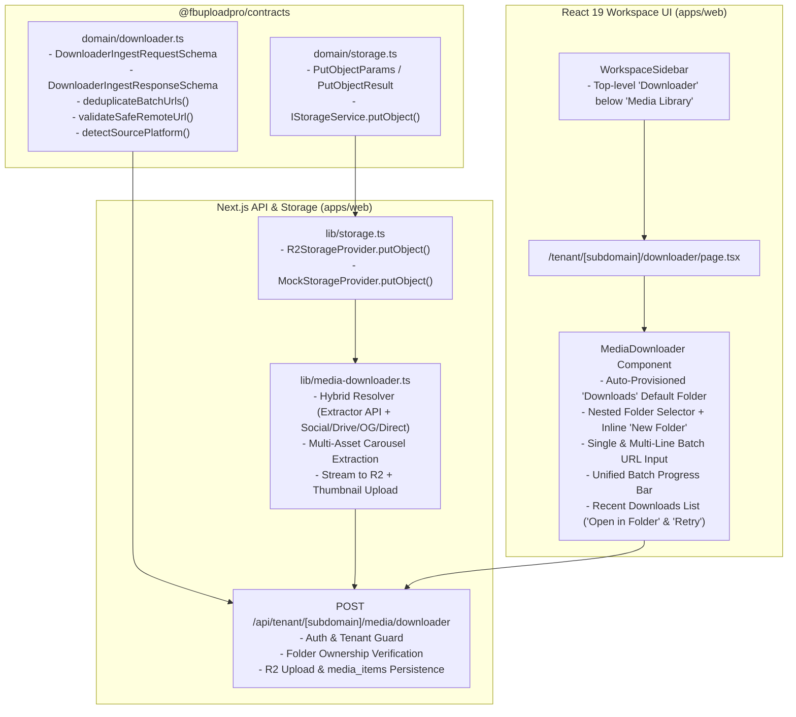

# Implementation Plan: Spec 031 — Cloud Media Downloader, Hybrid Link Resolution & Direct-to-R2 Ingestion

**Feature ID**: `031-cloud-media-downloader`  
**Specification**: [`spec.md`](./spec.md)  
**Created**: 2026-10-11

---

## 1. Architectural Overview

Spec 031 introduces the Cloud Media Downloader across `@fbuploadpro/contracts` and `@fbuploadpro/web`, enabling operators to paste one or multiple links and stream the resolved videos and images directly from the server into Cloudflare R2 and PostgreSQL `media_items` without saving files to the user's local PC.

---

## 2. Technical Context & Component Design

### 2.1 Storage Service Extension (`packages/contracts/src/domain/storage.ts` & `apps/web/src/lib/storage.ts`)
- Add `PutObjectParams` (`{ key: string; body: Uint8Array | Buffer; contentType: string }`) and `PutObjectResult` (`{ key: string; publicUrl: string; byteLength: number }`) to `packages/contracts/src/domain/storage.ts`.
- Extend `IStorageService` with `putObject(params: PutObjectParams): Promise<PutObjectResult>`.
- Implement `putObject` in `R2StorageProvider` using `PutObjectCommand` (`@aws-sdk/client-s3`) and in `MockStorageProvider` (tracking `uploadedObjects: Map<string, { contentType: string; byteLength: number }>`).

### 2.2 Domain Contracts & SSRF Guards (`packages/contracts/src/domain/downloader.ts`)
- `DownloaderSourcePlatformEnum`: `'tiktok' | 'facebook' | 'instagram' | 'x' | 'youtube' | 'google_drive' | 'dropbox' | 'direct' | 'web'`.
- `detectSourcePlatform(rawUrl: string)`: Classifies any URL into its canonical source platform.
- `validateSafeRemoteUrl(rawUrl: string)`:
  - Validates `http:` or `https:` protocol.
  - Blocks `localhost`, `.local`, `.internal`, IPv4 loopback (`127.0.0.0/8`), unspecified (`0.0.0.0/8`), link-local (`169.254.0.0/16`), RFC1918 private ranges (`10.0.0.0/8`, `172.16.0.0/12`, `192.168.0.0/16`), CGNAT (`100.64.0.0/10`), and IPv6 loopback/private/link-local (`::1`, `fc00::/7`, `fe80::/10`, `::ffff:127.*`, etc.).
- `deduplicateBatchUrls(rawInput: string)`:
  - Splits multi-line input by line breaks, trims whitespace, ignores blank lines, validates URLs via `validateSafeRemoteUrl`, deduplicates identical normalized URLs while preserving order, and returns `{ urls: string[], duplicateCount: number, invalidUrls: string[] }`.
- `DownloaderIngestRequestSchema`:
  - `url`: `z.string().trim().url().max(2048)`
  - `folderId`: `z.string().uuid().nullable().optional()`
- `DownloaderIngestResponseSchema`:
  - `sourceUrl`: `z.string().url()`
  - `platform`: `DownloaderSourcePlatformEnum`
  - `items`: `z.array(MediaItemResponseSchema).min(1)`

### 2.3 Hybrid Link Resolver & R2 Streamer (`apps/web/src/lib/media-downloader.ts`)
- `resolveMediaFromUrl(sourceUrl: string, options)`:
  1. **SSRF Validation**: Validates `sourceUrl` via `validateSafeRemoteUrl`.
  2. **Cloud Drive URL Normalization**:
     - Transforms Google Drive share URLs (`drive.google.com/file/d/<id>/view`) into direct download stream URLs (`https://drive.google.com/uc?export=download&id=<id>`).
     - Transforms Dropbox share URLs (`?dl=0` $\rightarrow$ `?dl=1` / `dl.dropboxusercontent.com`).
  3. **Pluggable External Extractor (`DOWNLOADER_EXTRACTOR_API_URL`)**:
     - When `process.env.DOWNLOADER_EXTRACTOR_API_URL` is configured, sends a `POST` request compatible with Cobalt / `yt-dlp` JSON APIs (`{ url: sourceUrl }`) and maps single (`tunnel`/`redirect`/`stream`) or multi-item (`picker`) responses into `ResolvedRemoteMediaAsset[]`.
  4. **Built-In Serverless Social & Web Resolvers**:
     - For TikTok (`tiktok.com`, `vm.tiktok.com`), X/Twitter (`x.com`, `twitter.com` via `api.fxtwitter.com` / `api.vxtwitter.com` JSON metadata), Facebook/Instagram/YouTube/Web pages: inspects HTTP `Content-Type`.
     - If the response is directly an allowed binary media MIME type (`video/mp4`, `video/quicktime`, `video/webm`, `image/jpeg`, `image/png`, `image/webp`) or has a recognized media file extension with `application/octet-stream`, streams the binary directly.
     - If the response is HTML/JSON, extracts post caption/title (`og:description`, `og:title`, `twitter:description`, JSON-LD `VideoObject.description`/`name`, or `<title>`), thumbnail URL (`og:image`, `twitter:image`, JSON-LD `thumbnailUrl`), and all video/image media URLs (`og:video:secure_url`, `og:video`, `og:video:url`, `twitter:player:stream`, JSON-LD `contentUrl`, `<video src>`, or `og:image` when no video is present, plus multi-item carousel arrays).
  5. **Binary Download & R2 Cloud Upload**:
     - Validates every resolved media stream URL and thumbnail URL against `validateSafeRemoteUrl`.
     - Enforces the `524,288,000` byte (500 MB) ceiling (`MAX_MEDIA_DOWNLOAD_BYTES`).
     - Uploads the binary directly to R2 via `storage.putObject({ key: mediaKey, body, contentType })` and optional thumbnail to `storage.putObject({ key: thumbnailKey, body: thumbBody, contentType: thumbMime })`.
     - Computes `captionText`: uses extracted post caption/title (if non-empty, trimmed to max 5000 chars), falling back to `deriveDefaultCaptionFromFilename(fileName)`.

### 2.4 Backend Endpoint (`apps/web/src/app/api/tenant/[subdomain]/media/downloader/route.ts`)
- `POST /api/tenant/[subdomain]/media/downloader`:
  1. Verifies `fbup_session` cookie and checks `session.subdomain === subdomain || session.role === 'admin'`.
  2. Validates payload with `DownloaderIngestRequestSchema` and `validateSafeRemoteUrl`.
  3. If `folderId` is non-null, verifies `SELECT id FROM media_folders WHERE id = $1 AND user_id = $2` (returns `404 FOLDER_NOT_FOUND` if missing or owned by another tenant).
  4. Resolves media assets via `resolveAndUploadMediaFromUrl`, inserts each asset into `media_items` (`user_id = session.userId`, `folder_id = body.folderId ?? null`, `caption_text`), and returns `201 Created` with `DownloaderIngestResponse`.

### 2.5 Frontend Navigation & Downloader UI (`apps/web/src/components/workspace/workspace-sidebar.tsx` & `apps/web/src/components/media/media-downloader.tsx`)
- **`WorkspaceSidebar`**:
  - Adds `Downloader` `SidebarMenuItem` directly below `Media Library` in the top `SidebarGroup`, linking to `/tenant/${subdomain}/downloader` with a cloud-download icon.
- **`MediaDownloader` (`apps/web/src/components/media/media-downloader.tsx`)**:
  - **Auto-Provisioned `Downloads` Folder**:
    - Fetches `/api/tenant/${subdomain}/media/folders` on mount.
    - Looks for a root-level folder (`parentId === null`) where `name.toLowerCase() === 'downloads'`.
    - If found, selects its `id` as `selectedFolderId`. If not found, automatically sends `POST /api/tenant/${subdomain}/media/folders` with `{ name: 'Downloads', parentId: null }`, adds it to the folder list, and selects its `id` as `selectedFolderId`.
  - **Destination Folder Selector & Inline `New Folder` Creation**:
    - Renders `data-testid="downloader-folder-select"` listing `All Media (Root)` and all nested folders with full path labels (`formatFolderAncestryPath`).
    - Renders `data-testid="downloader-new-folder-button"` (`New Folder`), opening a modal/inline dialog to create a new folder (at root or under the currently selected folder) and immediately selecting it.
  - **Single & Batch URL Input**:
    - Multi-line `<textarea data-testid="downloader-url-input">` supporting 1 or multiple URLs (one per line).
    - Inline field error display (`role="alert"`) when empty or containing only invalid URLs.
    - Primary action button (`data-testid="downloader-submit-button"`) using `COMPONENT_STYLES.primaryButton` (`Save to Media Library`).
  - **Unified Batch Progress Banner (`data-testid="downloader-batch-progress"`)**:
    - Displays a single Windows Copy-style progress bar (`Saving X of Y links to Media Library...`, percentage complete, and duplicate skipped count notice if any).
  - **Recent Downloads List (`data-testid="downloader-recent-list"`)**:
    - Displays each processed download entry:
      - **Saved**: Asset thumbnail/video preview, filename, auto-populated `captionText`, file size, target folder path, and **`Open in Folder`** button (`data-testid="downloader-open-folder-btn"`) navigating to `/tenant/${subdomain}/media?folder=${folderId}` (or `/tenant/${subdomain}/media` for root).
      - **Failed**: Source URL, clear customer-safe error message, and **`Retry`** button (`data-testid="downloader-retry-btn"`) to re-run that URL.

---

## 3. Constitution Check

- **Principle I (SDD & TDD)**: Full spec, plan, contracts, and task breakdown created before code; unit and integration tests cover contracts, storage, API route, sidebar, and UI.
- **Principle III (Multi-Tenant Isolation)**: All `media_items` and `media_folders` operations enforce `user_id = session.userId` and verify folder ownership.
- **Principle IV (Zero-Trust Validation & SSRF)**: Strict Zod schemas (`DownloaderIngestRequestSchema`) and SSRF protection (`validateSafeRemoteUrl`) on every URL and redirect hop.
- **Principle 8 (Theme Token Authority)**: All UI styles reference `THEME`, `PALETTE`, `RADII`, `SPACING`, `TYPOGRAPHY`, and `COMPONENT_STYLES` from `apps/web/src/lib/theme.ts`. Zero modifications to `DESIGN.md`.
- **Principle 9 (UX Writing Standards)**: Clear, conversational customer copy with zero technical jargon or decorative status dots.
- **Principle 23 (Cloud Media Downloader)**: 100% alignment with all 6 sub-clauses of Principle 23.
