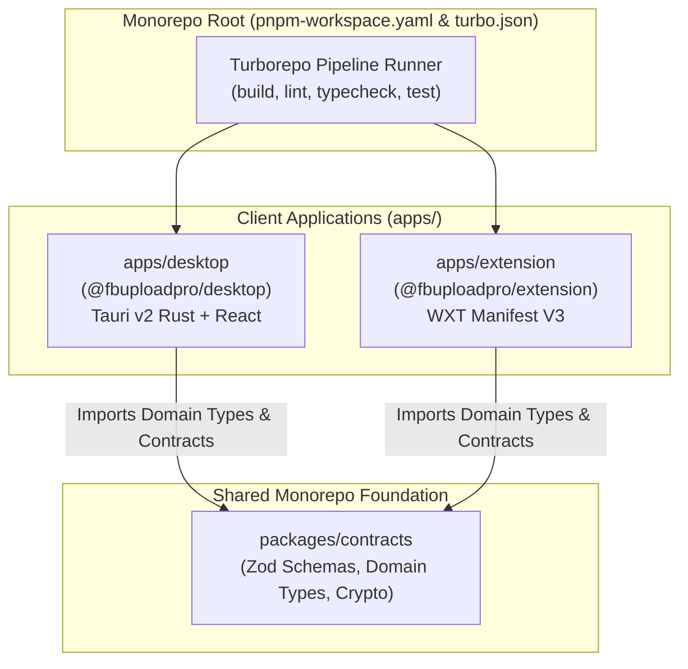

# Implementation Plan: Spec 033 — Client Shells Scaffolding (Desktop Tauri v2 & Extension WXT MV3)

**Specification**: [`specs/033-client-shells-desktop-extension/spec.md`](./spec.md)  
**Status**: Ready for Implementation  
**Constitution Reference**: FBUploadPro Constitution v2.24.0 (Principle 26)  

---

## 1. Technical Architecture Blueprint

---

## 2. Package Configurations & Manifests

### 2.1 Desktop Application Shell (`apps/desktop`)
* **`apps/desktop/package.json`**:
  * Name: `@fbuploadpro/desktop`
  * Scripts: `build`, `typecheck`, `lint`, `test`
  * Workspace Dependencies: `@fbuploadpro/contracts`
* **`apps/desktop/tsconfig.json`**:
  * Extends: `../../tsconfig.base.json`
  * Target: `ES2022`, Module: `ESNext`, ModuleResolution: `Bundler`, Lib: `ES2022`, `DOM`
* **`apps/desktop/src/index.ts`**:
  * Export `DesktopShellConfig` and contract type imports.
* **`apps/desktop/src-tauri/Cargo.toml`**:
  * Package: `fbuploadpro-desktop` (Rust 2021 edition)
  * Release profile: `strip = true`, `opt-level = 3`
* **`apps/desktop/src-tauri/tauri.conf.json`**:
  * Tauri v2 schema configuration, window layout (1280x800).
* **`apps/desktop/src-tauri/src/main.rs`**:
  * Native Rust entrypoint.

### 2.2 Browser Extension Shell (`apps/extension`)
* **`apps/extension/package.json`**:
  * Name: `@fbuploadpro/extension`
  * Scripts: `build`, `typecheck`, `lint`, `test`
  * Workspace Dependencies: `@fbuploadpro/contracts`
* **`apps/extension/tsconfig.json`**:
  * Extends: `../../tsconfig.base.json`
  * Target: `ES2022`, Module: `ESNext`, ModuleResolution: `Bundler`, Lib: `ES2022`, `DOM`
* **`apps/extension/src/index.ts`**:
  * Export `ExtensionShellConfig` and contract type imports.
* **`apps/extension/manifest.json`**:
  * Manifest V3 cross-browser metadata, permissions (`activeTab`, `storage`).

---

## 3. Quality Gates Verification Strategy

1. `pnpm install`: Automatically links `@fbuploadpro/desktop` and `@fbuploadpro/extension` into workspace lockfile.
2. `pnpm turbo run build lint typecheck test`: Runs across all 6 workspace packages (`web`, `worker`, `desktop`, `extension`, `contracts`, `database`).
3. Unit tests: Provide smoke unit test assertions verifying shell configuration objects and contract exports.
