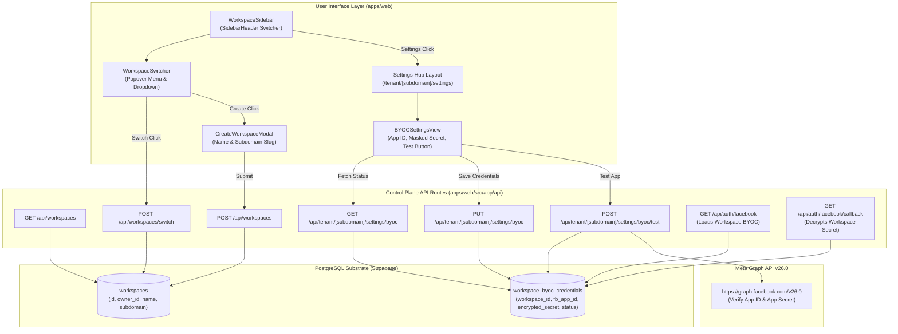

# Plan: Spec 037 - Workspace Switcher, Dedicated Settings Hub & Strict BYOC Facebook Credentials

## 1. Architectural Blueprint & Data Flow

---

## 2. Technical Stack & Implementation Boundary

1. **Database Schema (`supabase/migrations/20261013110000_workspace_byoc_credentials.sql`)**:
   - `workspaces`:
     - `id UUID PRIMARY KEY DEFAULT gen_random_uuid()`
     - `owner_id UUID NOT NULL REFERENCES users(id) ON DELETE CASCADE`
     - `name VARCHAR(100) NOT NULL`
     - `subdomain VARCHAR(50) NOT NULL UNIQUE`
     - `created_at TIMESTAMPTZ NOT NULL DEFAULT now()`
     - `updated_at TIMESTAMPTZ NOT NULL DEFAULT now()`
     - Backfills existing users from `users` table.
   - `workspace_byoc_credentials`:
     - `id UUID PRIMARY KEY DEFAULT gen_random_uuid()`
     - `workspace_id UUID NOT NULL REFERENCES workspaces(id) ON DELETE CASCADE`
     - `user_id UUID NOT NULL REFERENCES users(id) ON DELETE CASCADE`
     - `fb_app_id VARCHAR(100) NOT NULL`
     - `encrypted_fb_app_secret TEXT NOT NULL`
     - `webhook_verify_token VARCHAR(255)`
     - `status VARCHAR(30) NOT NULL DEFAULT 'unverified' CHECK (status IN ('unverified', 'valid', 'invalid'))`
     - `last_tested_at TIMESTAMPTZ`
     - `created_at TIMESTAMPTZ NOT NULL DEFAULT now()`
     - `updated_at TIMESTAMPTZ NOT NULL DEFAULT now()`
     - `CONSTRAINT uq_workspace_byoc UNIQUE (workspace_id)`
     - `CONSTRAINT uq_workspace_byoc_user UNIQUE (user_id, workspace_id)`

2. **Domain Contracts (`@fbuploadpro/contracts`)**:
   - `WorkspaceItemSchema`, `CreateWorkspaceRequestSchema`, `SwitchWorkspaceRequestSchema`
   - `BYOCCredentialsViewSchema`, `SaveBYOCCredentialsRequestSchema`, `TestBYOCResponseSchema`
   - AES-256-GCM encryption helper consumption (`encryptToken` and `decryptToken`).

3. **API Implementation (`apps/web/src/app/api`)**:
   - `apps/web/src/app/api/workspaces/route.ts`: List owned workspaces & create new workspace.
   - `apps/web/src/app/api/workspaces/switch/route.ts`: Validate ownership & re-issue `fbup_session` cookie.
   - `apps/web/src/app/api/tenant/[subdomain]/settings/byoc/route.ts`: Get sanitized credentials & save encrypted credentials.
   - `apps/web/src/app/api/tenant/[subdomain]/settings/byoc/test/route.ts`: Direct test against Graph API v26.0.
   - Update `/api/auth/facebook/route.ts` and `/api/auth/facebook/callback/route.ts` for workspace-scoped dynamic BYOC loading and decryption.

4. **UI Implementation (`apps/web`)**:
   - `WorkspaceSwitcher` (`apps/web/src/components/workspace/workspace-switcher.tsx`):
     - Uses shadcn `SidebarMenuButton size="lg"` with `ChevronsUpDown`.
     - Popover menu with current workspace indicator, list of workspaces, create button, settings link.
   - `CreateWorkspaceModal` (`apps/web/src/components/workspace/create-workspace-modal.tsx`):
     - Clean dialog adhering to `DESIGN.md` and `apps/web/src/lib/theme.ts`.
     - Live subdomain validation and URL preview.
   - Dedicated Settings Hub (`apps/web/src/app/tenant/[subdomain]/settings/`):
     - Tabbed navigation: `General`, `BYOC Facebook App`, `Audit Logs`.
     - `GeneralSettingsView`: Workspace details.
     - `BYOCSettingsView`: Full Facebook App credential control center with masked secret, eye toggle, copy helpers, permission checklist, and live test connection.
     - `AuditLogsView`: Activity log.
   - Updated `WorkspaceSidebar` and `WorkspaceUserMenu` with settings navigation links.

5. **Security & Encryption Standards**:
   - `FB_ENCRYPTION_MASTER_KEY` / `TOKEN_ENCRYPTION_KEY` used for AES-256-GCM symmetric encryption.
   - Raw secrets are never sent to the client; `hasSecret` boolean indicates presence.
   - Multi-tenant compounds enforced on all database queries (`WHERE workspace_id = $1 AND user_id = $2`).
