# Data Model & Schema: Spec 043

## 1. Database Table: `media_download_jobs`

Tracks background download jobs on Cloudflare Workers.

```sql
CREATE TYPE media_download_job_status AS ENUM (
  'queued',
  'downloading',
  'processing',
  'completed',
  'failed',
  'cancelled'
);

CREATE TABLE media_download_jobs (
  id UUID PRIMARY KEY DEFAULT gen_random_uuid(),
  user_id UUID NOT NULL REFERENCES auth.users(id) ON DELETE CASCADE,
  source_url TEXT NOT NULL,
  source_platform VARCHAR(32) NOT NULL DEFAULT 'direct',
  target_folder_id UUID REFERENCES media_folders(id) ON DELETE SET NULL,
  custom_filename VARCHAR(255),
  status media_download_job_status NOT NULL DEFAULT 'queued',
  progress_percent SMALLINT NOT NULL DEFAULT 0 CHECK (progress_percent BETWEEN 0 AND 100),
  total_bytes BIGINT,
  downloaded_bytes BIGINT NOT NULL DEFAULT 0,
  media_id UUID REFERENCES media_items(id) ON DELETE SET NULL,
  error_code VARCHAR(64),
  error_message TEXT,
  metadata JSONB NOT NULL DEFAULT '{}'::jsonb,
  created_at TIMESTAMPTZ NOT NULL DEFAULT now(),
  updated_at TIMESTAMPTZ NOT NULL DEFAULT now()
);
```

### Constraints & Indexes
- `idx_download_jobs_user_status`: Index on `(user_id, status)` for fast tenant job filtering.
- `idx_download_jobs_created_at`: Index on `(user_id, created_at DESC)` for recent jobs queries.
- Row Level Security (RLS) enabled: Users can only select and update their own jobs (`auth.uid() = user_id`).

---

## 2. Job Lifecycle State Machine

```mermaid
stateDiagram-v2
    [*] --> queued: Enqueued via /api/media/download/enqueue
    queued --> downloading: Worker initiates fetch & opens R2 stream
    downloading --> processing: Stream finished; creating thumbnail & DB record
    processing --> completed: media_items inserted & quota updated
    queued --> failed: SSRF blocked or quota exceeded
    downloading --> failed: Stream error, timeout, or > 500 MB
    processing --> failed: Media DB insert error
    downloading --> cancelled: User manually aborts job
    completed --> [*]
    failed --> [*]
    cancelled --> [*]
```


