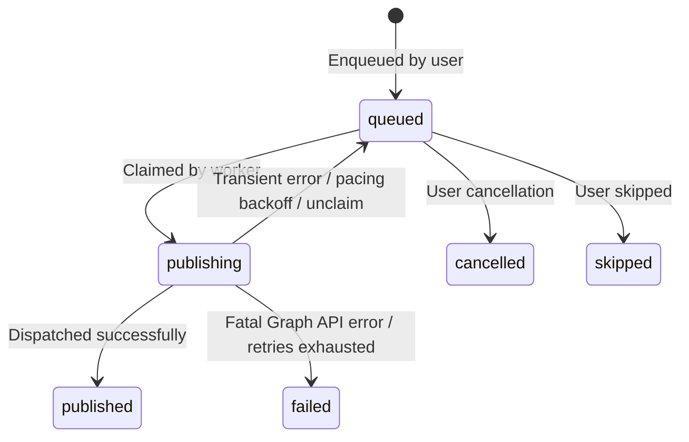
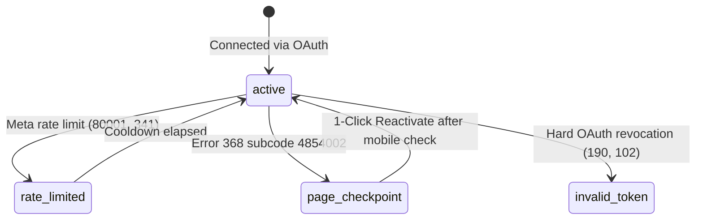
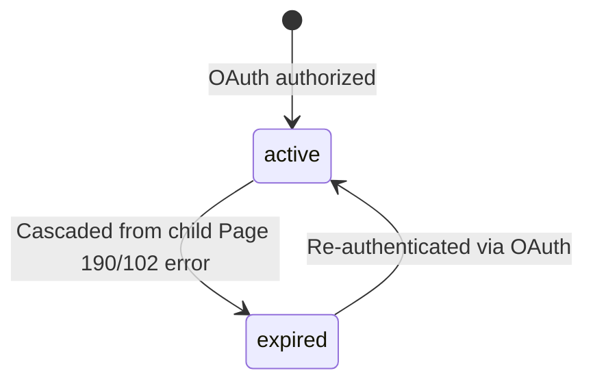

# Data Model & Schema Migrations: Platform Audit Remediation (Spec 045)

**Feature Branch**: `fix/045-platform-audit-remediation`  
**Date**: 2026-10-15  

This document specifies the database schema evolution, constraints, indexes, and stored procedures required to remediate all issues identified in [`issues.md`](file:///home/agent/.gemini/antigravity/worktrees/fbuploadpro/sync_latest_main_code/issues.md).

---

## 1. Table Alterations & Constraints

### 1.1 `public.queue_items`
```sql
-- 1. Allow Text posts with media_id = NULL
ALTER TABLE public.queue_items ALTER COLUMN media_id DROP NOT NULL;

-- 2. Add canonical post format and link URL
ALTER TABLE public.queue_items 
  ADD COLUMN IF NOT EXISTS post_format TEXT NOT NULL DEFAULT 'reel' 
  CHECK (post_format IN ('text', 'image', 'reel', 'video', 'story'));

ALTER TABLE public.queue_items 
  ADD COLUMN IF NOT EXISTS link_url TEXT;

-- 3. Constraint: Text posts have NO media_id; media posts MUST have media_id
ALTER TABLE public.queue_items 
  DROP CONSTRAINT IF EXISTS chk_queue_items_format_media;

ALTER TABLE public.queue_items 
  ADD CONSTRAINT chk_queue_items_format_media 
  CHECK (
    (post_format = 'text' AND media_id IS NULL) OR 
    (post_format <> 'text' AND media_id IS NOT NULL)
  );

-- 4. Constraint: Story posts MUST NOT have first comments
ALTER TABLE public.queue_items 
  DROP CONSTRAINT IF EXISTS chk_queue_items_story_no_comment;

ALTER TABLE public.queue_items 
  ADD CONSTRAINT chk_queue_items_story_no_comment 
  CHECK (post_format <> 'story' OR first_comment IS NULL);

-- 5. Performance index for fair-share partitioned claims
CREATE INDEX IF NOT EXISTS idx_queue_items_claim_partition 
  ON public.queue_items (fb_page_id, scheduled_time ASC) 
  WHERE status = 'queued';
```

### 1.2 `public.facebook_pages`
```sql
-- Add rate-limit backoff pacing columns
ALTER TABLE public.facebook_pages 
  ADD COLUMN IF NOT EXISTS next_allowed_publish_at TIMESTAMPTZ,
  ADD COLUMN IF NOT EXISTS buc_usage_pct INT DEFAULT 0;

CREATE INDEX IF NOT EXISTS idx_facebook_pages_publish_pacing 
  ON public.facebook_pages (id, next_allowed_publish_at);
```

### 1.3 `public.page_queue_slots`
```sql
-- Add format awareness to recurring publishing slots
ALTER TABLE public.page_queue_slots 
  ADD COLUMN IF NOT EXISTS allowed_formats TEXT[] 
  DEFAULT ARRAY['reel', 'video', 'image', 'text', 'story'];
```

### 1.4 `public.media_items`
```sql
-- Persist pixel dimensions for format eligibility validation
ALTER TABLE public.media_items 
  ADD COLUMN IF NOT EXISTS width INT,
  ADD COLUMN IF NOT EXISTS height INT;

-- Composite index for fast folder duplicate checking
CREATE INDEX IF NOT EXISTS idx_media_items_duplicate_check 
  ON public.media_items (folder_id, file_size, LOWER(name));

-- Keyset cursor pagination index
CREATE INDEX IF NOT EXISTS idx_media_items_cursor_pagination 
  ON public.media_items (folder_id, created_at DESC, id DESC);
```

---

## 2. Stored Procedures & Atomic Functions

### 2.1 `settle_queue_item_outcome`
Atomically settles publishing outcomes, updates queue status, sets Page pacing/status, and cascades OAuth expiration to parent Facebook Account:
```sql
CREATE OR REPLACE FUNCTION public.settle_queue_item_outcome(
  p_item_id UUID,
  p_status TEXT, -- 'published' | 'failed' | 'queued' (retry)
  p_error_message TEXT DEFAULT NULL,
  p_fb_post_id TEXT DEFAULT NULL,
  p_next_retry_at TIMESTAMPTZ DEFAULT NULL,
  p_page_status TEXT DEFAULT NULL,
  p_account_status TEXT DEFAULT NULL,
  p_next_allowed_publish_at TIMESTAMPTZ DEFAULT NULL,
  p_buc_usage_pct INT DEFAULT NULL
)
RETURNS VOID
LANGUAGE plpgsql
SECURITY DEFINER
AS $$
DECLARE
  v_page_id UUID;
  v_account_id UUID;
  v_user_id UUID;
BEGIN
  -- 1. Fetch item context
  SELECT qi.fb_page_id, fp.fb_account_id, qi.user_id 
  INTO v_page_id, v_account_id, v_user_id
  FROM public.queue_items qi
  JOIN public.facebook_pages fp ON fp.id = qi.fb_page_id
  WHERE qi.id = p_item_id;

  IF NOT FOUND THEN
    RAISE EXCEPTION 'Queue item % not found', p_item_id;
  END IF;

  -- 2. Update queue item outcome
  UPDATE public.queue_items
  SET 
    status = p_status,
    error_message = p_error_message,
    fb_post_id = COALESCE(p_fb_post_id, fb_post_id),
    scheduled_time = COALESCE(p_next_retry_at, scheduled_time),
    updated_at = now()
  WHERE id = p_item_id;

  -- 3. Update Page status & pacing if provided
  IF v_page_id IS NOT NULL THEN
    UPDATE public.facebook_pages
    SET 
      status = COALESCE(p_page_status, status),
      next_allowed_publish_at = COALESCE(p_next_allowed_publish_at, next_allowed_publish_at),
      buc_usage_pct = COALESCE(p_buc_usage_pct, buc_usage_pct),
      updated_at = now()
    WHERE id = v_page_id;

    -- Defer sibling items if Page entered rate-limit pacing
    IF p_next_allowed_publish_at IS NOT NULL AND p_next_allowed_publish_at > now() THEN
      UPDATE public.queue_items
      SET scheduled_time = p_next_allowed_publish_at, updated_at = now()
      WHERE fb_page_id = v_page_id AND status = 'queued' AND scheduled_time < p_next_allowed_publish_at;
    END IF;
  END IF;

  -- 4. Atomically cascade account status (e.g. 'expired') to parent Facebook Account
  IF p_account_status = 'expired' AND v_account_id IS NOT NULL THEN
    UPDATE public.facebook_accounts
    SET status = 'expired', updated_at = now()
    WHERE id = v_account_id AND user_id = v_user_id;
  END IF;
END;
$$;
```

### 2.2 `claim_due_queue_items` (Fair-Share Partitioned)
Claims up to `p_limit` items, capped at `p_max_per_page` per page, skipping pages in rate limit cooldown:
```sql
CREATE OR REPLACE FUNCTION public.claim_due_queue_items(
  p_limit INT DEFAULT 50,
  p_max_per_page INT DEFAULT 3
)
RETURNS SETOF public.queue_items
LANGUAGE plpgsql
SECURITY DEFINER
AS $$
BEGIN
  RETURN QUERY
  WITH eligible_candidates AS (
    SELECT 
      qi.id,
      ROW_NUMBER() OVER (PARTITION BY qi.fb_page_id ORDER BY qi.scheduled_time ASC) as page_rank
    FROM public.queue_items qi
    JOIN public.facebook_pages fp ON fp.id = qi.fb_page_id
    WHERE qi.status = 'queued'
      AND qi.scheduled_time <= now()
      AND (fp.next_allowed_publish_at IS NULL OR fp.next_allowed_publish_at <= now())
      AND fp.status = 'active'
    ORDER BY qi.scheduled_time ASC
  ),
  selected_items AS (
    SELECT id FROM eligible_candidates
    WHERE page_rank <= p_max_per_page
    LIMIT p_limit
    FOR UPDATE SKIP LOCKED
  )
  UPDATE public.queue_items qi
  SET status = 'publishing', updated_at = now()
  FROM selected_items si
  WHERE qi.id = si.id
  RETURNING qi.*;
END;
$$;
```

### 2.3 `recover_stuck_publishing_items`
Resets items that have been in `'publishing'` state for longer than timeout:
```sql
CREATE OR REPLACE FUNCTION public.recover_stuck_publishing_items(
  p_timeout_minutes INT DEFAULT 10
)
RETURNS INT
LANGUAGE plpgsql
SECURITY DEFINER
AS $$
DECLARE
  v_recovered_count INT;
BEGIN
  WITH stuck AS (
    SELECT id FROM public.queue_items
    WHERE status = 'publishing'
      AND updated_at <= now() - (p_timeout_minutes || ' minutes')::INTERVAL
    FOR UPDATE SKIP LOCKED
  )
  UPDATE public.queue_items qi
  SET status = 'queued', updated_at = now()
  FROM stuck s
  WHERE qi.id = s.id;

  GET DIAGNOSTICS v_recovered_count = ROW_COUNT;
  RETURN v_recovered_count;
END;
$$;
```

---

## 3. Entity State Machines

### 3.1 Queue Item State Machine


### 3.2 Facebook Page Health State Machine


### 3.3 Facebook Account State Machine

