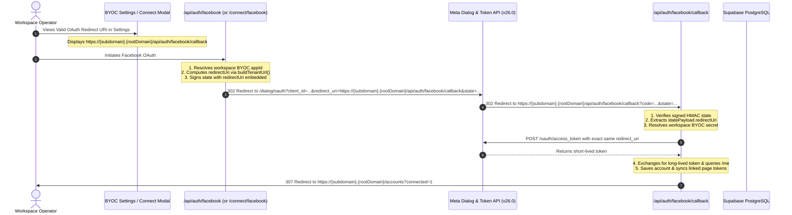

# Technical Plan: 047 Workspace Subdomain BYOC OAuth Alignment

**Feature Directory**: `specs/047-workspace-subdomain-oauth`  
**Status**: In Implementation  
**Created**: 2026-10-15  

---

## 1. Architecture Overview



---

## 2. Component Architecture & Changes

### 2.1 Contracts (`packages/contracts/src/domain/oauth.ts`)
- Update `OAuthStatePayloadSchema`:
  ```ts
  export const OAuthStatePayloadSchema = z.object({
    tenantSubdomain: z.string().min(1).max(50),
    userId: z.string().uuid(),
    nonce: z.string().min(16),
    iat: z.number().int(),
    exp: z.number().int(),
    isMagic: z.boolean().optional(),
    expectedFbAccountId: z.string().min(1).optional(),
    expectedDisplayName: z.string().min(1).optional(),
    redirectUri: z.string().url().optional(),
  });
  ```
- No database migration is needed because state envelopes are ephemeral, signed in-memory JWTs.

### 2.2 Direct OAuth Initiation (`apps/web/src/app/api/auth/facebook/route.ts`)
- Read `rootDomain`:
  ```ts
  const rootDomain = process.env.NEXT_PUBLIC_ROOT_DOMAIN || '';
  ```
- Construct `redirectUri`:
  ```ts
  const redirectUri = buildTenantUrl(
    session.subdomain,
    '/api/auth/facebook/callback',
    request.url,
    rootDomain
  ).toString();
  ```
- Include `redirectUri` in the payload passed to `signOAuthState`.
- Supply `redirectUri` as query parameter to `https://www.facebook.com/v26.0/dialog/oauth`.

### 2.3 Magic Link OAuth Initiation (`apps/web/src/app/connect/facebook/route.ts`)
- Read `rootDomain`:
  ```ts
  const rootDomain = process.env.NEXT_PUBLIC_ROOT_DOMAIN || '';
  ```
- Construct `redirectUri`:
  ```ts
  const redirectUri = buildTenantUrl(
    payload.tenantSubdomain,
    '/api/auth/facebook/callback',
    request.url,
    rootDomain
  ).toString();
  ```
- Include `redirectUri` in the payload passed to `signOAuthState`.
- Pass to Meta dialog.

### 2.4 OAuth Callback & Token Exchange (`apps/web/src/app/api/auth/facebook/callback/route.ts`)
- Read `redirectUri` from verified `statePayload`:
  ```ts
  const effectiveRedirectUri =
    statePayload.redirectUri ||
    (statePayload.tenantSubdomain
      ? buildTenantUrl(
          statePayload.tenantSubdomain,
          '/api/auth/facebook/callback',
          request.url,
          rootDomain
        ).toString()
      : redirectUri);
  ```
- Use `effectiveRedirectUri` in `POST https://graph.facebook.com/v26.0/oauth/access_token`.

### 2.5 BYOC Settings View UI (`apps/web/src/components/settings/byoc-settings-view.tsx`)
- Compute `redirectUri` and `webhookUrl` robustly from `window.location.origin`:
  ```ts
  const origin =
    typeof window !== 'undefined' && window.location.origin
      ? window.location.origin
      : 'https://fbuploadpro.com';

  const redirectUri = `${origin}/api/auth/facebook/callback`;
  const webhookUrl = `${origin}/api/webhooks/facebook`;
  ```
- Works identically across `shahzebpycozgy.vinsmokemedia.online`, custom domains, and local `http://localhost:3000`.

---

## 3. Backward Compatibility & Resilience
1. **Fallback for Missing State `redirectUri`**: If a callback is received for a state generated before this change, the callback falls back to `buildTenantUrl(statePayload.tenantSubdomain, ...)` or `NEXT_PUBLIC_APP_URL`.
2. **Local Development**: On `localhost`, `buildTenantUrl` produces clean local URLs without trying to access nonexistent external DNS.
3. **Multi-tenant Isolation**: Each workspace's tokens are exchanged and stored under their own `workspace_id`.
