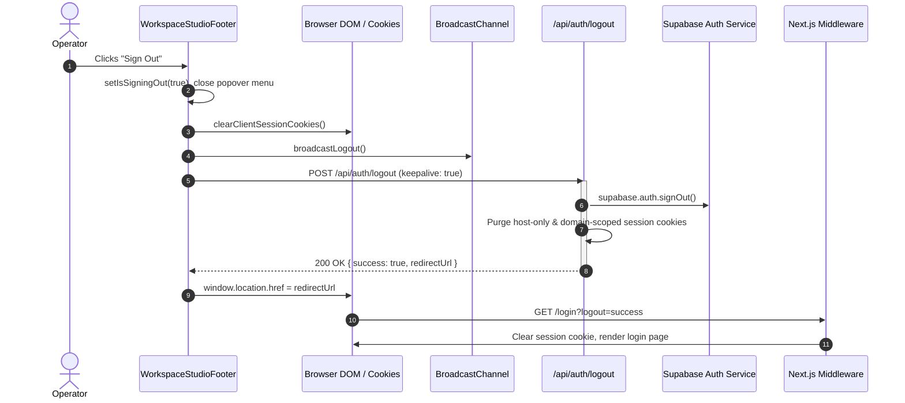

# Spec 056: Technical Architecture & Implementation Plan — Sidebar Sign-Out Resilience

## 1. Architectural Overview
This technical plan defines the implementation architecture to ensure robust, secure, and resilient user sign-out from the workspace sidebar studio footer across local development, Vercel preview, and production environments.

### 1.1 Architecture & Flow


### 1.2 Target Components & Modules
1. **`apps/web/src/components/workspace/workspace-studio-footer.tsx`**:
   - Introduce `isSigningOut` state in `WorkspaceStudioFooter`.
   - Pass `isSigningOut` into `PopoverMenuActions`.
   - Update `PopoverMenuActions` sign-out button to:
     - Render "Signing out..." when `isSigningOut` is true, else "Sign Out".
     - Set `disabled={isSigningOut}` and `aria-disabled={isSigningOut}`.
     - Set `cursor: isSigningOut ? 'not-allowed' : 'pointer'` and dimmed opacity.
   - Upgrade `handleSignOut` to `async`:
     - Set `isSigningOut(true)`.
     - Call `clearClientSessionCookies()` and `broadcastLogout()`.
     - Issue `fetch('/api/auth/logout', { method: 'POST', keepalive: true })`.
     - Extract `redirectUrl` from response JSON if successful.
     - Redirect to `targetRedirectUrl` or fallback to `redirectToLogout()`.
     - Ensure `setIsOpen(false)` dismisses the popover.

2. **`packages/contracts/src/domain/routing.ts`**:
   - In `resolveRequestGatewayBase`:
     - Detect if `cleanHost` is a local hostname (`localhost`, `127.0.0.1`, `*.localhost`).
     - If `cleanHost` is local and `cleanRoot` is non-local (e.g. defaulted to `'fbuploadpro.com'`), adapt `effectiveRoot = 'localhost'`.
     - Never allow `resolveGatewayHost` to generate hybrid hosts like `app.fbuploadpro.com:3000`.

3. **`apps/web/src/app/api/auth/logout/route.ts`**:
   - Align default `rootDomain` fallback from `'fbuploadpro.com'` to `'localhost:3000'` for local parity with other routes and middleware (`process.env.NEXT_PUBLIC_ROOT_DOMAIN || 'localhost:3000'`).

4. **Testing Suite**:
   - Unit tests in `apps/web/tests/ui/workspace-sidebar.test.tsx` verifying the sign-out button triggers the server endpoint, shows loading state, and handles redirection.
   - Contract tests in `packages/contracts/tests/routing.test.ts` verifying `buildCentralAppUrl` local fallback behavior.

---

## 2. Technical Contracts & Implementation Details

### A. Asynchronous Handler in `WorkspaceStudioFooter`
```typescript
  const [isSigningOut, setIsSigningOut] = useState(false);

  const handleSignOut = useCallback(async () => {
    let targetRedirectUrl: string | null = null;
    try {
      setIsSigningOut(true);
      setIsOpen(false);
      clearClientSessionCookies();
      broadcastLogout();
      try {
        const res = await fetch('/api/auth/logout', { method: 'POST', keepalive: true });
        if (res.ok) {
          const data = await res.json().catch(() => null);
          if (data?.redirectUrl) {
            targetRedirectUrl = data.redirectUrl;
          }
        }
      } catch {
        // Resilient fallback if offline or network degraded
      }
    } finally {
      if (targetRedirectUrl && typeof window !== 'undefined') {
        window.location.href = targetRedirectUrl;
      } else {
        redirectToLogout();
      }
    }
  }, []);
```

### B. Routing Gateway Fix in `packages/contracts/src/domain/routing.ts`
```typescript
function resolveRequestGatewayBase(
  parsedUrl: URL,
  cleanRoot: string,
  rootPort?: string
): string | null {
  const cleanHost = parsedUrl.hostname.toLowerCase();
  if (cleanHost.endsWith('.vercel.app')) {
    return parsedUrl.origin;
  }

  const isLocalHost = isLocalHostname(cleanHost);
  const isLocalRoot = isLocalHostname(cleanRoot);
  const isLocal = isLocalHost || isLocalRoot;
  const protocol = isLocal ? 'http:' : 'https:';

  let port = rootPort;
  if (!port && parsedUrl.port) {
    port = parsedUrl.port;
  } else if (!port && isLocalHost) {
    port = '3000';
  }

  // Prevent invalid hybrid host creation (e.g. app.fbuploadpro.com:3000) when running on localhost
  const effectiveRoot = isLocalHost && !isLocalRoot ? 'localhost' : cleanRoot;
  const host = resolveGatewayHost(effectiveRoot, isLocal, port);
  return `${protocol}//${host}`;
}
```

---

## 3. Constitution & Quality Gates Check
- **Principle 6 & Principle 15 (Gateway Isolation & Central Routing)**: Compliant. Logout redirects route to canonical gateway `app.{rootDomain}` or local origin.
- **Theme & Design Standards**: Compliant. All styles use `@/lib/theme` (`PALETTE.accent3`, `SPACING`, `RADII`, `TYPOGRAPHY`).
- **Single Agent Mode**: Compliant. Directly executed by single unified engineer.
- **No Local Build/Checks Rule**: Compliant. Quality validation offloaded to GitHub Actions CI upon PR creation.
