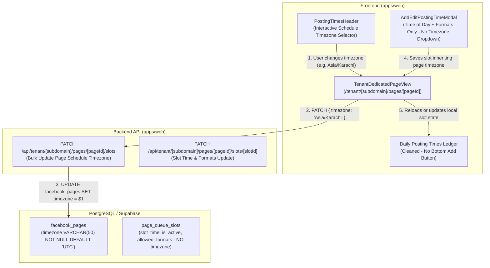

# Architecture & Technical Plan: Spec 060 - Page Schedule Timezone & Posting Times Cleanup

## 1. Overview & Architecture Strategy
This plan details the technical decoupling of timezone selection from individual posting slots to a unified page-level schedule setting, the removal of the redundant bottom add button, and the simplification of the posting time modal.

---

## 2. Component & API Architecture

---

## 3. Detailed Changes by Package

### 3.0 Database Migration
- **File**: `supabase/migrations/20261020010000_page_level_schedule_timezone_normalization.sql`
- Adds `timezone VARCHAR(50) NOT NULL DEFAULT 'UTC'` to `facebook_pages`.
- Backfills `facebook_pages.timezone` from `page_queue_slots.timezone` where available.
- Drops `timezone` column from `page_queue_slots`.

### 3.1 `@fbuploadpro/contracts`
- **File**: `packages/contracts/src/domain/database.ts`: Add `timezone: string` to `DatabaseFacebookPageRow`.
- **File**: `packages/contracts/src/domain/facebook.ts`: Add `timezone: z.string().default('UTC')` to `FacebookPageSchema` and `FacebookPageViewSchema`.
- **File**: `packages/contracts/src/domain/queue.ts`:
  - Add `UpdateQueueScheduleTimezoneRequestSchema = z.object({ timezone: TimezoneSchema })`.
  - Export `UpdateQueueScheduleTimezoneRequest`.
  - `timezone` optional on `CreateQueueSlotRequestSchema` and `UpdateQueueSlotRequestSchema` for backward compatibility.
  - `PageQueueSlotSchema` defaults `timezone: 'UTC'`.

### 3.2 Backend Routes
- `apps/web/src/app/api/tenant/[subdomain]/pages/[pageId]/slots/route.ts`:
  - `handleListQueueSlots`: Queries `facebook_pages.timezone` and attaches it to returned slots.
  - `handleCreateQueueSlot`: Queries `facebook_pages.timezone`, inserts slot into `page_queue_slots` (without timezone column), returns slot with `page.timezone`.
  - `handleUpdateQueueScheduleTimezone`: Executes `UPDATE facebook_pages SET timezone = $1, updated_at = now() WHERE id = $2 AND user_id = $3`.
- `apps/web/src/app/api/tenant/[subdomain]/pages/[pageId]/slots/[slotId]/route.ts`:
  - `handleUpdateQueueSlot`: Excludes `timezone` from `page_queue_slots` update query, returns `page.timezone`.
- `apps/web/src/app/api/tenant/[subdomain]/publishing/queue/route.ts`:
  - Queries `facebook_pages.timezone` and maps it onto slots passed to `calculateNextVacantSlot`.

### 3.3 UI Component (`apps/web/src/components/pages/dedicated/tab-posting-times.tsx`)
- Update `PageTabPostingTimesProps`:
  - Add `onUpdateTimezone?: (newTimezone: string) => Promise<void>`.
- Expand `COMMON_TIMEZONES`:
  - Include `Asia/Karachi`, `Asia/Dubai`, `Asia/Kolkata` along with existing UTC, US, and European timezones.
- Update `PostingTimesHeader`:
  - Add `onUpdateTimezone?: (newTimezone: string) => Promise<void>` prop.
  - Replace static timezone badge with an interactive schedule timezone selector containing a styled `<select>` element.
  - When user selects a new timezone, call `onUpdateTimezone(selectedTimezone)`.
- Update `AddEditPostingTimeModal`:
  - Remove `Timezone` label and `<select>` dropdown.
  - Display informative context: "Active schedule timezone: {activeTimezone}".
  - Retain `Time of Day (24-Hour)` input and `Permitted Content Formats` multi-select chips.
  - On submit, automatically package `timezone: activeTimezone`.
- Remove redundant bottom button:
  - Remove lines 1122-1164 (`+ Add another posting time` button block) from `PageTabPostingTimes`.

### 3.4 Page Container (`apps/web/src/app/tenant/[subdomain]/pages/[pageId]/page.tsx`)
- Add `handleUpdateTimezone(newTimezone: string)`:
  - Calls `PATCH /api/tenant/${subdomain}/pages/${pageId}/slots` with `{ timezone: newTimezone }`.
  - Optimistically updates all items in `slots` state with the new timezone.
  - Triggers a non-blocking `fetchSlots()` refresh.
  - Displays a toast notification: `Schedule timezone updated to ${newTimezone}.`
- Pass `onUpdateTimezone={handleUpdateTimezone}` to `PageTabCalendar` / `PageTabPostingTimes`.

### 3.5 Artifact & Documentation
- Update `posting_times_preview.html`:
  - Reflect removal of bottom button.
  - Include interactive schedule timezone selector in header.
  - Update modal to show only Time and Formats.
- Update `docs/foundational-knowledge.md`:
  - Document Spec 060 architectural decisions under Section 26.
