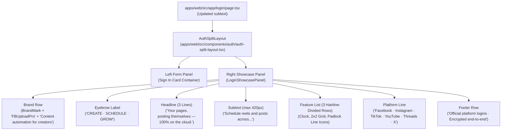

# Architectural Plan: Spec 061 - Login Showcase Panel Redesign

## 1. Architecture Overview
This plan specifies the component hierarchy, design token bindings, and responsive layout adaptations required to modernize the `/login` right-side showcase panel and update the sign-in card subtext.



---

## 2. Component Design & Implementation

### A. `LoginShowcasePanel` (`apps/web/src/components/auth/login-showcase-panel.tsx`)
A dedicated presentational component encapsulating the showcase panel structure:
- **Brand Row**:
  - `BrandMark` from `@/components/brand` (`size={32}`).
  - Title: `"FBUploadPro"`, `fontWeight: TYPOGRAPHY.weights.bold`, `fontSize: '1.125rem'`, `color: var(--text-main, #ffffff)`.
  - Subtitle: `"Content automation for creators"`, `fontSize: '0.8125rem'`, `color: var(--text-sub, #9ca3af)`.
- **Eyebrow Label**:
  - Pure unboxed text (no card, no pill, no border, no background box).
  - Text: `"CREATE · SCHEDULE · GROW"`.
  - Styling: `color: PALETTE.primary`, `textTransform: 'uppercase'`, `letterSpacing: '0.12em'`, `fontWeight: TYPOGRAPHY.weights.semibold`, `fontSize: '0.75rem'`.
- **Headline**:
  - Three distinct lines with preserved line breaks:
    ```tsx
    <h1 style={{ ... }}>
      Your pages,<br />
      posting themselves —<br />
      <span style={{ color: PALETTE.primary }}>100% on the cloud.</span>
    </h1>
    ```
  - Styling: `fontSize: '2rem'`, `lineHeight: 1.25`, `fontWeight: TYPOGRAPHY.weights.heavy`, `letterSpacing: TYPOGRAPHY.tracking.h1`, `color: 'var(--text-main, #ffffff)'`.
- **Subtext**:
  - Constrained width: `maxWidth: '420px'`.
  - Text: `"Schedule reels and posts across Facebook, Instagram, TikTok, YouTube, Threads, and X — they go live while you sleep, even when your laptop is closed."`
  - Styling: `fontSize: '0.9375rem'`, `lineHeight: 1.5`, `color: 'var(--text-sub, #9ca3af)'`.
- **Feature List**:
  - Three rows separated by hairline borders (`1px solid var(--border-subtle, #1f242d)`).
  - Each row uses an inline SVG line icon in `PALETTE.primary` (strokeWidth: 2, fill: none):
    - Row 1: Clock (`<circle cx="12" cy="12" r="10" /><polyline points="12 6 12 12 16 14" />`) | `"Post from anywhere"` | `"Schedule from your phone or laptop — your posts publish from the cloud."`
    - Row 2: 2x2 Grid (`<rect x="3" y="3" width="7" height="7" rx="1" /><rect x="14" y="3" width="7" height="7" rx="1" /><rect x="14" y="14" width="7" height="7" rx="1" /><rect x="3" y="14" width="7" height="7" rx="1" />`) | `"Every platform, one dashboard"` | `"Connect each account once, then run everything from a single place."`
    - Row 3: Padlock (`<rect width="18" height="11" x="3" y="11" rx="2" ry="2" /><path d="M7 11V7a5 5 0 0 1 10 0v4" />`) | `"Your accounts stay yours"` | `"You sign in through each platform directly — your passwords never leave them."`
  - Row Title: `fontWeight: TYPOGRAPHY.weights.semibold`, `fontSize: '0.875rem'`, `color: 'var(--text-main, #ffffff)'`.
  - Row Desc: `fontSize: '0.8125rem'`, `color: 'var(--text-sub, #9ca3af)'`, `lineHeight: 1.45`.
- **Platform Line**:
  - Small, muted text: `"Facebook · Instagram · TikTok · YouTube · Threads · X"`.
  - Styling: `fontSize: '0.75rem'`, `color: 'var(--text-dim, #6b7280)'`.
- **Trust Footer Row**:
  - Left-aligned: `"Official platform logins · Encrypted end-to-end"`.
  - Styling: `fontSize: '0.75rem'`, `color: 'var(--text-dim, #6b7280)'`.
  - Strictly no "See how it works" link.

### B. `AuthSplitLayout` Support (`apps/web/src/components/auth/auth-split-layout.tsx`)
- Add `showcase?: React.ReactNode` to `AuthSplitLayoutProps`.
- Render `{showcase}` inside `.auth-showcase-panel` if provided; otherwise fall back to default showcase content.
- Update `@media (max-width: 1023px)` styles:
  - Flex direction on `.auth-split-wrapper`: `column`.
  - `.auth-showcase-panel`: `order: 1`, `display: flex !important`, `max-width: 100% !important`, `min-height: auto !important`, `padding: 36px 20px !important`, `border-right: none !important`, `border-left: none !important`, `border-bottom: 1px solid var(--border-subtle, #1f242d)`.
  - `.auth-form-panel`: `order: 2`, `flex: 1 1 100% !important`, `max-width: 100% !important`, `padding: 32px 16px !important`.
  - `.auth-mobile-header`: `display: none !important` when showcase is stacked above.

### C. `LoginPage` (`apps/web/src/app/login/page.tsx`)
- Update `description` prop on `AuthSplitLayout` to:
  `"Welcome back! Sign in to keep your content flowing across every platform."`
- Pass `showcase={<LoginShowcasePanel />}` into `AuthSplitLayout`.

---

## 3. Test & Verification Plan
- Unit test suite: `apps/web/tests/ui/login-showcase-panel.test.tsx` verifying:
  - All exact text strings (brand tagline, eyebrow, headline lines, subtext, 3 feature titles and descriptions, platform line, trust footer).
  - Absence of emojis, absence of "See how it works" link.
  - Presence of 3 inline SVG icons in primary theme color.
  - Responsive stacking order in split layout.
- Update `apps/web/tests/components/auth-pages.test.tsx` to assert new `LoginPage` description string.
