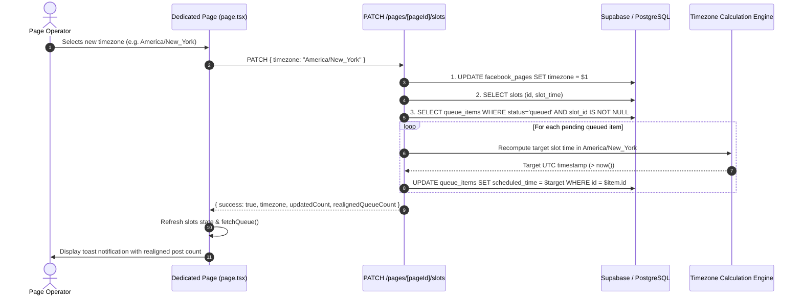

# Architecture & Implementation Plan: Spec 061 - Queued Items Timezone Realignment

## 1. Overview & Architectural Strategy
When an operator modifies a Facebook page's schedule timezone, all future slot calculations naturally adopt the new timezone. However, pending posts sitting in `queue_items` with `status = 'queued'` and `slot_id IS NOT NULL` hold fixed UTC timestamps that were computed under the previous timezone.

This plan details the technical design of an atomic queue realignment mechanism that:
1. Detects all pending recurring slot items for the page.
2. Recalculates their `scheduled_time` to match their recurring slot hour (`slot_time`) in the newly selected timezone.
3. Applies past-time protection: if shifting to the new timezone produces a timestamp in the past (`<= now()`), it automatically advances the post forward to the next future occurrence.
4. Updates the Next.js API route, database queries (both Postgres and Supabase clients), contracts, frontend notifications, and comprehensive test suites.

---

## 2. Sequence & Flow Architecture



---

## 3. Detailed Component Plan

### 3.1 Timezone Realignment Helper (`apps/web/src/lib/slot-scheduler.ts`)
- Function: `recomputeSlotScheduledTime(params: { originalScheduledTime: Date; slotTime: string; newTimezone: string; now?: Date }): Date`
  - Extracts the intended calendar year/month/day.
  - Combines with `slotTime` (HH:MM:SS) in `newTimezone`.
  - Converts to UTC Date.
  - If calculated UTC Date is `<= now`, advances by 24 hours (or next day) so it is strictly in the future.
  - Returns the realigned `Date`.

### 3.2 Backend Route (`apps/web/src/app/api/tenant/[subdomain]/pages/[pageId]/slots/route.ts`)
- Extend `updateScheduleTimezonePostgres`:
  - Updates `facebook_pages.timezone`.
  - Fetches pending items:
    ```sql
    SELECT qi.id, qi.slot_id, qi.scheduled_time, s.slot_time
    FROM queue_items qi
    JOIN page_queue_slots s ON s.id = qi.slot_id
    WHERE qi.fb_page_id = $1 AND qi.user_id = $2 AND qi.status = 'queued'
    ORDER BY qi.scheduled_time ASC
    ```
  - For each item, computes new timestamp in `newTimezone` and updates `queue_items`.
  - Returns `{ updatedCount, realignedQueueCount }`.
- Extend `updateScheduleTimezoneSupabase`:
  - Performs equivalent update using Supabase client.
- In `handleUpdateQueueScheduleTimezone`:
  - Returns `NextResponse.json({ success: true, timezone: newTimezone, updatedCount, realignedQueueCount })`.

### 3.3 Page Container (`apps/web/src/app/tenant/[subdomain]/pages/[pageId]/page.tsx`)
- In `handleUpdateTimezone`:
  - Reads `realignedQueueCount` from the response.
  - Formats friendly notification:
    `Schedule timezone updated to ${newTimezone}${realignedQueueCount ? ` (${realignedQueueCount} pending post${realignedQueueCount > 1 ? 's' : ''} realigned)` : ''}.`
  - Calls `fetchQueue()` alongside `fetchSlots()` to refresh the live queue view with shifted times.

### 3.4 Verification & Tests
- `apps/web/tests/api/queue-slots.test.ts`:
  - Add test verifying `PATCH /api/tenant/[subdomain]/pages/[pageId]/slots` shifts pending `queue_items` and returns `realignedQueueCount`.
  - Verify items with `slot_id = null` (one-off posts) are untouched.
  - Verify items that would land in the past are bumped into the future.
- `apps/web/tests/security/publishing-isolation.test.ts`:
  - Ensure cross-tenant isolation prevents realigning queue items belonging to other tenants.
