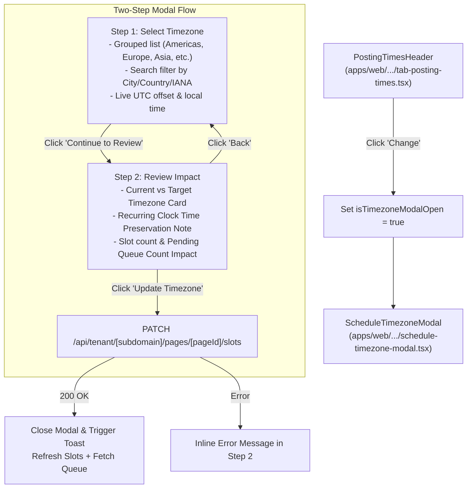

# Technical Architecture & Plan: Spec 062 - Two-Step Professional Schedule Timezone Modal

## 1. Architecture & Component Hierarchy

---

## 2. Component Design & Responsibilities

### 2.1 `ScheduleTimezoneModal` (`apps/web/src/components/pages/dedicated/schedule-timezone-modal.tsx`)
- Props:
  - `isOpen: boolean`
  - `currentLocationTimezone: string` (current page timezone, defaults to UTC)
  - `slotsCount: number` (total recurring slots configured)
  - `pendingQueueCount: number` (count of pending items in queue)
  - `onClose: () => void`
  - `onUpdateTimezone: (newTimezone: string) => Promise<{ realignedQueueCount?: number }>`
- Internal State:
  - `step: 1 | 2`
  - `searchQuery: string`
  - `selectedTimezone: string`
  - `isSubmitting: boolean`
  - `errorMessage: string | null`
- Step 1 View:
  - Current timezone badge with local time.
  - Search input with clear button.
  - Scrollable container rendering grouped timezone options.
  - Radio/indicator styling adhering to `apps/web/src/lib/theme.ts`.
  - Footer with Cancel button and "Continue to Review" button.
- Step 2 View:
  - Step indicator ("Step 2 of 2: Review Schedule Impact").
  - Comparison preview card showing `From: <currentTimezone>` to `To: <selectedTimezone>`.
  - Impact notes explaining:
    - Recurring posting times (e.g., 10:00 AM) retain their clock times in the new timezone.
    - Pending queued items linked to slots will automatically shift forward without posting in the past.
  - Summary badges: `<slotsCount> recurring slots affected` and `<pendingQueueCount> queued posts realigned`.
  - Footer with "Back" button and "Confirm & Update" button with loading state.

### 2.2 Timezone Registry (`apps/web/src/lib/timezones.ts` or scoped helper)
- Curated list of major world cities and business centers categorized into:
  - North & South America (`America/New_York`, `America/Chicago`, `America/Denver`, `America/Los_Angeles`, `America/Toronto`, `America/Sao_Paulo`, etc.)
  - Europe (`Europe/London`, `Europe/Paris`, `Europe/Berlin`, `Europe/Madrid`, `Europe/Rome`, `Europe/Amsterdam`, etc.)
  - Asia & Middle East (`Asia/Karachi`, `Asia/Dubai`, `Asia/Kolkata`, `Asia/Singapore`, `Asia/Tokyo`, `Asia/Hong_Kong`, `Asia/Bangkok`, etc.)
  - Australia & Pacific (`Australia/Sydney`, `Australia/Melbourne`, `Pacific/Auckland`, etc.)
  - Africa (`Africa/Cairo`, `Africa/Johannesburg`, `Africa/Lagos`, `Africa/Nairobi`, etc.)
  - Coordinated Universal Time (`UTC`)
- Each entry contains:
  - `iana: string` (e.g. `'Asia/Karachi'`)
  - `city: string` (e.g. `'Karachi'`)
  - `country: string` (e.g. `'Pakistan'`)
  - `region: string` (e.g. `'Asia'`)
  - `utcOffset: string` (computed or standard, e.g. `'UTC+05:00'`)

### 2.3 Integration with `tab-posting-times.tsx`
- Replace the raw `<select>` in `PostingTimesHeader` with an unboxed, luminous timezone display and a "Change" button.
- Add `isTimezoneModalOpen` state in `TabPostingTimes`.
- Pass `activeTimezone`, `slots.length`, and `pendingQueueCount` to `ScheduleTimezoneModal`.
- On successful update, call `onUpdateTimezone(newTimezone)` which invokes the existing `handleUpdateTimezone` handler in `page.tsx`.

---

## 3. Quality & Theme Compliance
- Strict token import from `apps/web/src/lib/theme.ts`.
- Zero capsule pill badges.
- Accessible modal dialog attributes (`role="dialog"`, `aria-modal="true"`, focus trap on open, escape to close).
