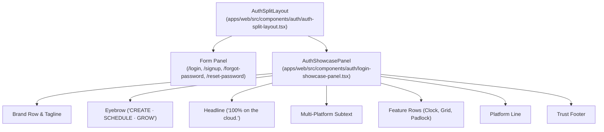

# Architectural Plan: Spec 064 - Default Auth Showcase Panel Standardization

## 1. Architectural Strategy
Standardize `AuthShowcasePanel` as the singular canonical showcase panel across all authentication pages by binding it directly as the default fallback in `AuthSplitLayout`, removing the legacy inline markup entirely.



---

## 2. Component Refactoring Details

### A. `login-showcase-panel.tsx`
- Export `AuthShowcasePanel` alongside `LoginShowcasePanel` as an alias for backwards compatibility.

### B. `auth-split-layout.tsx`
- Import `AuthShowcasePanel` from `@/components/auth/login-showcase-panel`.
- Delete:
  - `ShieldCheckIcon`, `CloudIcon`, `CommentIcon`, `LockIcon`
  - `VALUE_PILLARS`
  - Inline legacy showcase markup
- Update `showcaseNode`:
  ```tsx
  const showcaseNode = (
    <section
      className={`auth-showcase-panel${isFormLeft ? ' auth-showcase-right' : ''}`}
      aria-label="FBUploadPro Showcase"
    >
      {showcase ?? <AuthShowcasePanel />}
    </section>
  );
  ```

### C. Test Refactoring
- Update `apps/web/tests/auth/auth-components.test.tsx` to assert new canonical strings:
  - `"CREATE · SCHEDULE · GROW"`
  - `"100% on the cloud."`
  - `"Post from anywhere"`
  - `"Every platform, one dashboard"`
  - `"Your accounts stay yours"`
  - `"Facebook · Instagram · TikTok · YouTube · Threads · X"`
  - `"Official platform logins · Encrypted end-to-end"`
- Add verification that `/signup` renders the new showcase panel without requiring manual `showcase` prop injection.
