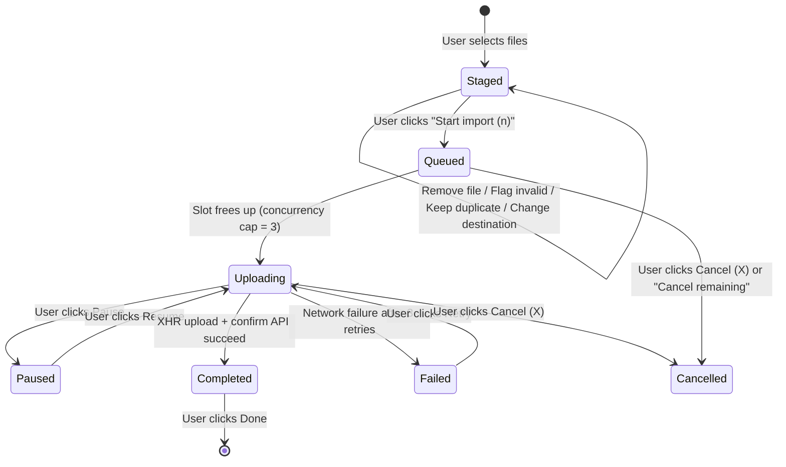

# Data Model: 072-import-media-dialog-updates

## Queue Item Model Extensions

```typescript
export interface ImportQueueItem {
  id: string;
  file: File;
  name: string;
  size: number;
  mimeType: string;
  mediaType: 'video' | 'image';
  destinationFolderId: string | null;
  status: 'staged' | 'queued' | 'uploading' | 'paused' | 'completed' | 'failed' | 'cancelled';
  progressPercent: number;
  isDuplicate: boolean;
  duplicateResolution?: 'keep' | 'skip';
  validationError: string | null;
  retryCount: number;
  previewUrl?: string | null; // Object URL for image thumbnail previews
  abortController?: AbortController;
  uploadedItem?: MediaItemResponse;
}
```

## State Machine Transitions


